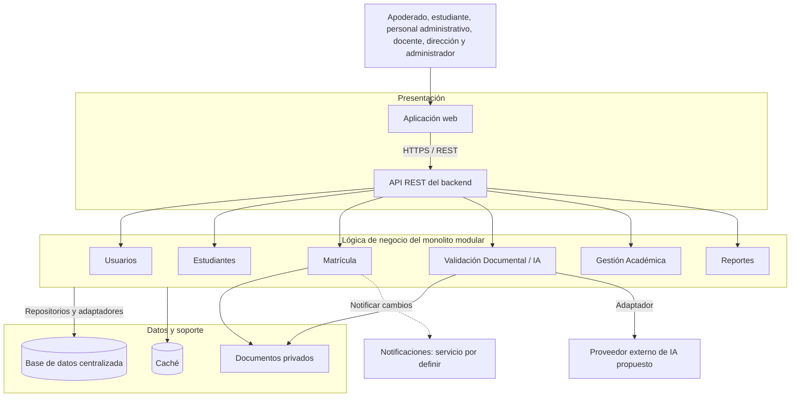

# Arquitectura inicial del sistema

> **Proyecto:** Sistema de matrícula y gestión académica para el colegio Mariscal Cáceres, Ayacucho.
> **Versión:** 1.0 · 

## 1. Objetivo

Presentar el sistema en tres capas conceptuales: presentación, lógica de negocio y datos. Esta vista simplificada no sustituye las cuatro áreas de Clean Architecture. La institución es una referencia académica: no existen entrevistas ni trabajo de campo, y los problemas y procesos son supuestos por validar.

## 2. Diagrama propuesto

## 3. Responsabilidades

| Capa | Responsabilidades |
|---|---|
| Presentación | Formularios y consultas; recibir HTTP, comprobar acceso mediante Usuarios, validar formatos y devolver respuestas |
| Lógica de negocio | Solicitudes, nuevos y continuadores, documentos, observaciones, vacantes, resolución humana e información académica |
| Datos y soporte | Persistencia, documentos privados y consultas frecuentes mediante adaptadores |

Se conservan los módulos de ADR-001. Validación Documental concentra la IA; Gestión Académica agrupa organización y seguimiento. Estudiantes y Reportes mantienen responsabilidades ya justificadas en el análisis. Matrícula confirma y consume cupos mediante una transacción; la caché no es autoridad para asignar vacantes.

## 4. Servicios externos

| Servicio propuesto | Uso y límite |
|---|---|
| IA | Extraer campos y detectar faltantes e inconsistencias; salida estructurada sujeta a validación humana. OpenRouter en evaluación |
| Notificaciones | Avisos de observaciones y estados según RF06; canal por confirmar |
| Identidad | RENIEC solo por evaluar con acceso autorizado; una simulación debe identificarse como tal y no es una integración real |

La IA no verifica autenticidad ni aprueba matrículas. Su fallo conserva la solicitud y permite revisión administrativa. Las demostraciones no enviarán documentos reales de estudiantes sin autorizaciones y salvaguardas correspondientes.

## 5. Supuestos y discrepancias pendientes

- El análisis incluye asistencia (RF18 y relacionados); el encargo la deja opcional. Se conserva como capacidad por confirmar sin eliminar requisitos previos. El asistente de consultas RF26 permanece como alcance previo sin detallarlo como módulo nuevo.
- El análisis plantea 2.000 usuarios concurrentes y el encargo menciona 2.000 por hora. Son magnitudes distintas: deben confirmarse el objetivo y el perfil de carga; no hay capacidad demostrada.
- RC08 usa SDD como desarrollo guiado por especificaciones; el encargo solicita un Software Design Document. Esta documentación describe el diseño, sin asumir que ambos significados sean equivalentes ni cambiar el análisis.
- Requisitos documentales, estados, permisos y políticas de aprobación requieren validación institucional.
- Se propone nube compatible con Cloudflare (RC07, ADR-010); tecnologías y ubicación de backend, datos y archivos siguen por definir. No hay despliegue acreditado.

Se prevén pruebas unitarias de reglas, integración con persistencia y proveedores simulados, carga y confirmaciones concurrentes. No se han ejecutado. Aumentar recursos o replicar el backend exige datos y archivos compartidos y sesiones compatibles; no garantiza una capacidad concreta.

## 6. Organización y referencias

Se reutiliza la carpeta existente arquitectura como sección equivalente a 02-arquitectura-software, evitando duplicar sus cuatro documentos. El conjunto con [diseño interno](../03-diseno-de-software/diseno-interno-de-modulos.md) y [C4](../04-modelo-c4/nivel1-contexto-del-sistema.md) constituye la descripción de diseño solicitada. Se conservan las [decisiones](../analisis-de-sistema/07-decisiones-arquitectonicas.md) en su ubicación.

Véanse [estilo](estilo-arquitectonico.md), [enfoque](enfoque/enfoque-%20arquitectonico.md) y [componentes](componentes-arquitectonicos.md).
