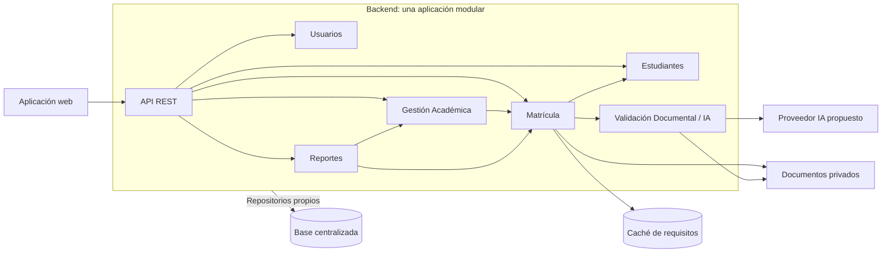

# Componentes arquitectónicos

> **Proyecto:** Sistema de matrícula y gestión académica para el colegio Mariscal Cáceres, Ayacucho.
> **Versión:** 1.0 · 

## 1. Objetivo

Resumir responsabilidades e interfaces conservando los módulos de ADR-001. Los niveles C4 detallados se desarrollan en [su sección](../04-modelo-c4/nivel3-componentes.md).

## 2. Vista general

Las flechas representan consumo de interfaces en ejecución, no dependencias de código hacia implementaciones.

## 3. Responsabilidades e interfaces

| Componente | Responsabilidad | Interfaz y dependencias |
|---|---|---|
| Aplicación web | Formularios, seguimiento y consultas por rol | API REST por HTTPS; sin claves externas |
| API REST | Entrada, formato, errores y control de acceso | Casos de uso y servicio de autorización de Usuarios |
| Usuarios | Cuentas, roles, permisos y configuración general | API pública de autorización; repositorio propio |
| Estudiantes | Datos de estudiantes y vínculos con apoderados | Consulta pública autorizada de estudiante y vínculo |
| Matrícula | Solicitudes, documentos, observaciones, cupos, constancias y decisión humana | Estudiantes, configuración académica y revisión documental mediante interfaces públicas |
| Validación Documental / IA | Asistencia documental y validación de salida | API pública de análisis; adaptadores de archivos e IA. La orientación RF26 puede alojarse aquí si se confirma |
| Gestión Académica | Periodos, grados, secciones, cursos, docentes e información académica | Consulta matrículas confirmadas; asistencia pendiente de confirmar |
| Reportes | Consultas y exportaciones | Interfaces autorizadas de Matrícula y Gestión Académica, sin leer sus tablas |
| Persistencia y almacenamiento | Datos y documentos privados | Adaptadores de cada módulo, sin permitir eludir sus límites |
| Caché | Consultas frecuentes de configuración | Lectura decorada, caducidad e invalidación; no decide cupos |

## 4. Restricciones y pendientes

Los módulos se despliegan juntos y se comunican mediante llamadas internas a interfaces públicas. Cada uno accede solo a sus tablas. Matrícula es el responsable propuesto del cupo y de su confirmación atómica; Gestión Académica administra la estructura escolar. Esta distribución de detalle debe validarse.

La autorización comprueba rol y vínculo con el estudiante. IA aporta observaciones preliminares y permite revisión manual ante fallos. Las notificaciones se conectarán por adaptador desde Matrícula al definir el canal. RENIEC requiere autorización; SIAGIE no se incorpora sin requisito ni acceso confirmado.

Frameworks, contratos, sesiones y tecnologías finales quedan pendientes. Véanse [arquitectura inicial](arquitectura-inicial.md) y [contenedores](../04-modelo-c4/nivel2-contenedores.md).
