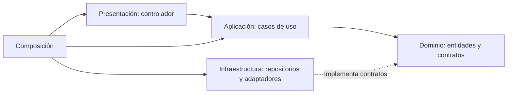

# Enfoque arquitectónico

> **Proyecto:** Sistema de matrícula y gestión académica para el colegio Mariscal Cáceres, Ayacucho.
> **Versión:** 1.0 ·

## 1. Clean Architecture

| Elemento | Aplicación al sistema escolar |
|---|---|
| Patrón / enfoque arquitectónico | Clean Architecture |
| Objetivo | Separar responsabilidades y dirigir dependencias hacia el dominio |
| Problema que resuelve | Evitar que reglas de matrícula dependan de la web, persistencia o proveedor IA |
| Capas definidas | Dominio, Aplicación, Presentación e Infraestructura |
| Beneficios | Mantenimiento, pruebas aisladas y sustitución de tecnología |

## 2. Áreas internas

| Área | Contenido en Matrícula | Dependencias permitidas |
|---|---|---|
| Dominio | SolicitudMatricula, EstadoSolicitud, DocumentoSolicitud y contratos SolicitudRepository, AlmacenDocumentos y RevisionDocumental | Solo dominio, sin frameworks |
| Aplicación | RegistrarSolicitudUseCase, RevisarSolicitudUseCase y ResolverSolicitudUseCase | Entidades y contratos del Dominio |
| Presentación | SolicitudController y rutas REST | Aplicación, sin SQL ni adaptadores concretos |
| Infraestructura | SolicitudRepositoryDB, AlmacenDocumentosPrivado y RevisionDocumentalAdapter | Dominio, bibliotecas técnicas e interfaz pública del módulo IA |
| Composición | Conexión de instancias | Todas las áreas para inyectar implementaciones |

La aplicación web es un cliente separado. Esta vista detalla el backend; no selecciona Angular, NestJS ni otro framework.

## 3. Regla de dependencia

Las flechas representan dependencias de código. El Dominio no importa áreas externas. Aplicación recibe contratos, sin instanciar clientes IA ni bases de datos. Infraestructura implementa esos contratos y composición selecciona implementaciones.

## 4. Ejemplo de Matrícula

El controlador identifica al apoderado autorizado y llama RegistrarSolicitudUseCase. El caso de uso crea una entidad válida y utiliza SolicitudRepository y AlmacenDocumentos. Sus adaptadores guardan la información sin exponer tecnología al Dominio.

RevisarSolicitudUseCase consume RevisionDocumental. Un adaptador interno llama la interfaz pública de Validación Documental / IA; allí AnalizarDocumentosUseCase usa ProveedorIAPort y un adaptador externo. La respuesta se valida y conserva como observación preliminar. ResolverSolicitudUseCase aplica después la decisión humana y el control transaccional de cupos.

## 5. Relación con las tres capas

La vista inicial agrupa interacción en Presentación, reglas y casos de uso en Lógica de negocio, y persistencia en Datos. Clean Architecture precisa las dependencias internas; no exige cuatro aplicaciones ni despliegues.

Los nombres y contratos son propuestas neutrales respecto del lenguaje. Documentos exigidos, permisos, estados y proveedor están por confirmar. Se conservan [ADR-002 y ADR-004](../../analisis-de-sistema/07-decisiones-arquitectonicas.md).

Véanse [diseño interno](../../03-diseno-de-software/diseno-interno-de-modulos.md), [SOLID](../../03-diseno-de-software/principios-de-diseno.md) y [estilo](../estilo-arquitectonico.md).
