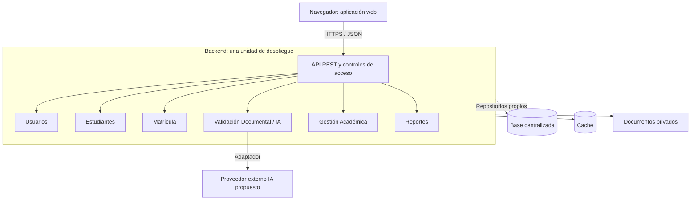

# Estilo arquitectónico

> **Proyecto:** Sistema de matrícula y gestión académica para el colegio Mariscal Cáceres, Ayacucho.
> **Versión:** 1.0 · **Estado:** diseño académico propuesto.

## 1. Cliente-servidor con backend monolítico modular

La aplicación web consume una API REST. El backend concentra los casos de uso y se despliega como una sola aplicación con módulos internos. Una base centralizada conserva la información; el cliente no accede directamente a ella.

## 2. Distribución de responsabilidades

| Parte | Función |
|---|---|
| Cliente | Formularios, adjuntos y consultas; no decide permisos ni cupos |
| API | Validar entradas, autenticar, autorizar y llamar casos de uso |
| Módulos | Usuarios: acceso; Estudiantes: datos y vínculos; Matrícula: solicitudes y cupos; Validación Documental / IA: revisión asistida; Gestión Académica: organización y seguimiento; Reportes: consultas |
| Infraestructura | Persistencia, caché, almacenamiento e integraciones |

Se conservan los módulos de ADR-001. El asistente RF26 puede ser una capacidad interna de IA; asistencia sigue por confirmar.

## 3. Comunicación e integridad

Los módulos se comunican mediante llamadas en memoria a interfaces públicas, sin acceder a tablas ajenas. Cada uno aplica Clean Architecture. Matrícula verifica vacantes y duplicados en una transacción de confirmación y registra responsable, fecha y motivo de la decisión humana.

IA y notificaciones usan adaptadores. Su operación no comparte la transacción de base de datos. Un fallo de IA conserva la solicitud y permite revisión manual. Los documentos son privados y las claves externas permanecen en el servidor.

## 4. Ventajas, límites y justificación

| Aspecto | Evaluación |
|---|---|
| Ventajas | Menos unidades de despliegue, trazabilidad simple y responsabilidades comprensibles |
| Limitaciones | Despliegue conjunto, recursos compartidos y disciplina para evitar acoplamiento |
| Evolución | Interfaces estables, cambios por módulo y aumento de capacidad según mediciones |
| Frente a microservicios | Permiten despliegue independiente, pero añaden operación y fallos distribuidos; el alcance académico no justifica esa complejidad |

El monolito modular facilita desarrollar progresivamente la propuesta. No garantiza una carga concreta. Se contempla nube compatible con Cloudflare según RC07 y ADR-010, sin afirmar despliegue.

## 5. Pendientes y referencias

Confirmar tecnologías, sesiones, proveedor IA y ubicación de componentes. Replicar el backend requerirá datos y documentos compartidos y una sesión independiente de cada instancia. Debe aclararse la diferencia entre 2.000 usuarios concurrentes y por hora antes de fijar pruebas.

Se conservan las [decisiones existentes](../analisis-de-sistema/07-decisiones-arquitectonicas.md). Véanse [enfoque](enfoque/enfoque-%20arquitectonico.md), [arquitectura inicial](arquitectura-inicial.md) y [C4 nivel 2](../04-modelo-c4/nivel2-contenedores.md).
