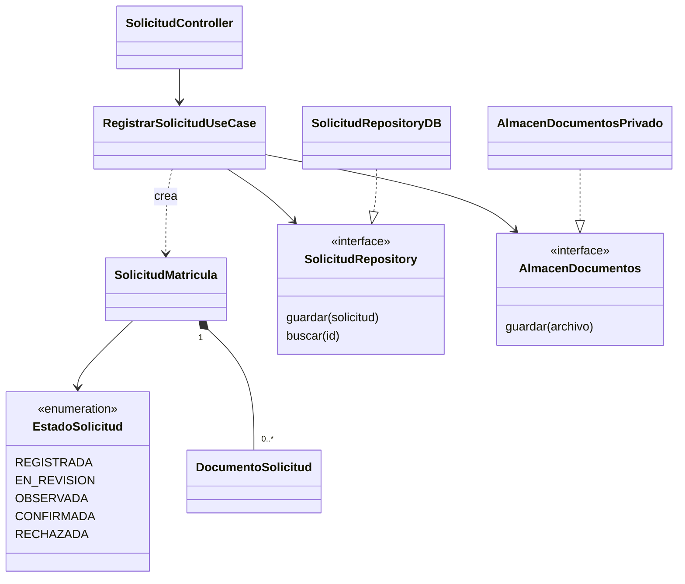

# Diseño interno de módulos

> **Proyecto:** Sistema de matrícula y gestión académica para el colegio Mariscal Cáceres, Ayacucho.
> **Versión documental:** 1.0 ·

## 1. Propósito

Definir una organización simple y uniforme del backend monolítico modular. Se detalla Matrícula porque coordina solicitudes, documentos, vacantes y decisiones administrativas. Las reglas institucionales y los requisitos documentales están pendientes de validación; no proceden de trabajo de campo.

## 2. Estructura propuesta

El siguiente árbol es conceptual: no representa archivos fuente existentes ni selecciona un lenguaje.

```text
backend/
  modulos/
    matricula/
      dominio/
        SolicitudMatricula
        EstadoSolicitud
        DocumentoSolicitud
        SolicitudRepository
        AlmacenDocumentos
        RevisionDocumental
      aplicacion/
        RegistrarSolicitudUseCase
        RevisarSolicitudUseCase
        ResolverSolicitudUseCase
      presentacion/
        SolicitudController
      infraestructura/
        SolicitudRepositoryDB
        AlmacenDocumentosPrivado
        RevisionDocumentalAdapter
      composicion
      interfaz-publica
```

| Elemento | Responsabilidad | Dependencias permitidas |
|---|---|---|
| `SolicitudMatricula` | Mantener datos, documentos, estado e historial | Dominio |
| `EstadoSolicitud` | Enumerar estados propuestos | Ninguna externa |
| `DocumentoSolicitud` | Referencia privada y metadatos del archivo | Dominio |
| `SolicitudRepository` | Contrato para guardar y recuperar solicitudes | Dominio |
| `AlmacenDocumentos` | Contrato para conservar y recuperar archivos autorizados | Dominio |
| `RevisionDocumental` | Contrato consumido por Matrícula para obtener asistencia | Dominio |
| `RegistrarSolicitudUseCase` | Validar datos básicos, registrar archivos y guardar la solicitud | Dominio |
| `RevisarSolicitudUseCase` | Coordinar análisis y guardar observaciones preliminares | Dominio |
| `ResolverSolicitudUseCase` | Aplicar una decisión humana autorizada y controlar la confirmación | Dominio |
| `SolicitudController` | Traducir HTTP, identificar al usuario y llamar casos de uso | Aplicación |
| `SolicitudRepositoryDB` | Implementar persistencia y control de versión | Dominio y controlador de base de datos |
| `AlmacenDocumentosPrivado` | Implementar almacenamiento con acceso restringido | Dominio y servicio de almacenamiento |
| `RevisionDocumentalAdapter` | Invocar la interfaz pública de Validación Documental / IA | Dominio e interfaz pública del módulo IA |
| Composición | Conectar implementaciones y casos de uso | Todas las áreas |

## 3. Capas y dependencias

Presentación depende de Aplicación y Aplicación de Dominio. Infraestructura implementa contratos del Dominio; el Dominio no importa frameworks, SQL ni proveedores. Solo la composición conoce las implementaciones concretas. El adaptador entre módulos evita que Matrícula importe las clases internas de IA.



Las flechas representan dependencias; el triángulo indica implementación de una interfaz y el rombo, composición. Los estados son propuestas, no políticas aprobadas. El estado del análisis IA (pendiente, disponible o fallido) se registra por separado y no determina la resolución administrativa.

## 4. Registro de una solicitud

| Paso | Participante | Acción propuesta |
|---|---|---|
| 1 | API y Usuarios | Autenticar y autorizar al apoderado respecto del estudiante |
| 2 | Controlador | Validar formato y traducir la petición a un comando |
| 3 | Caso de uso | Validar datos básicos, periodo y tipo nuevo/continuador, según configuración |
| 4 | Almacenamiento | Guardar documentos privados y devolver referencias |
| 5 | Repositorio | Guardar solicitud, referencias e historial inicial en una transacción |
| 6 | Controlador | Devolver identificador y estado REGISTRADA |

Registrar no equivale a confirmar ni reserva automáticamente una vacante. La revisión documental posterior puede solicitar IA, sin prolongar la transacción de registro. El flujo completo se presenta en [C4 nivel 4](../04-modelo-c4/nivel4-codigo.md).

## 5. Pseudocódigo ilustrativo, no implementado

```text
RegistrarSolicitudUseCase(repository, almacen):
  ejecutar(comando, identidadAutorizada):
    validarDatosBasicos(comando)
    verificarVinculoConEstudiante(identidadAutorizada, comando.estudiante)
    validarArchivosSegunConfiguracion(comando.archivos)
    referencias = almacen.guardarPrivado(comando.archivos)
    solicitud = SolicitudMatricula.registrar(comando, referencias)
    intentar:
      repository.guardarTransaccional(solicitud)
    si falla:
      solicitarLimpiezaDeArchivosSinReferencia(referencias)
      devolverErrorControlado()
    devolver solicitud.identificador
```

El repositorio concreto traduce la operación a la base de datos elegida. El controlador usa la identidad autenticada, no un identificador de apoderado confiado al formulario. La composición conecta `SolicitudRepositoryDB` y `AlmacenDocumentosPrivado`; no se requiere un framework específico.

## 6. Fallos, integridad y verificación prevista

Almacenamiento y base de datos no comparten necesariamente una transacción: si falla el archivo, no se confirma el registro; si falla la base de datos, se prevé limpieza de archivos huérfanos y una respuesta recuperable. Se propone una clave de idempotencia para reintentos; su política está por definir.

La confirmación humana debe comprobar requisitos configurados y vacantes reales, sin caché, y guardar matrícula, historial y consumo del cupo de forma atómica. Se propone que Matrícula sea responsable de ese cupo; Gestión Académica administra la estructura escolar y consulta matrículas por interfaces públicas. La asignación definitiva de responsabilidades requiere validación.

Se prevén pruebas unitarias con repositorios simulados, integración con persistencia y almacenamiento, y concurrencia sobre la última vacante. No se han ejecutado. Véanse [patrones](patrones-de-diseno.md), [SOLID](principios-de-diseno.md) y [decisiones existentes](../analisis-de-sistema/07-decisiones-arquitectonicas.md).
