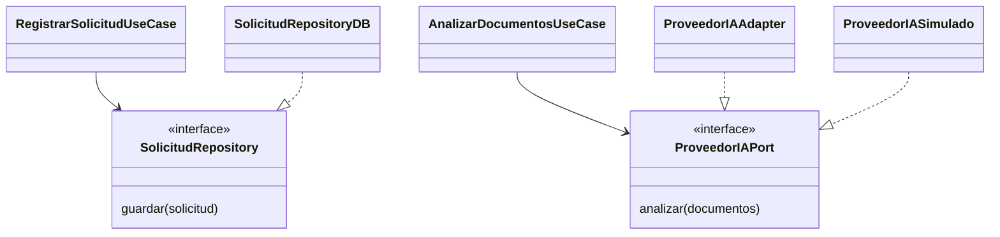
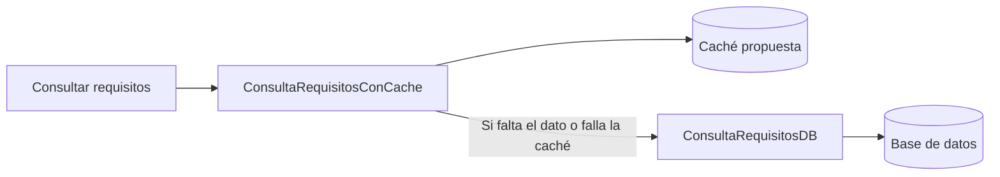

# Patrones de diseño

> **Proyecto:** Sistema de matrícula y gestión académica para el colegio Mariscal Cáceres, Ayacucho.
> **Versión documental:** 1.0 · 

## 1. Objetivo

Seleccionar patrones que mantengan los casos de uso independientes de la persistencia y los servicios externos. Se conserva el monolito modular con Clean Architecture; las tecnologías concretas quedan por confirmar.

## 2. Patrones seleccionados y opción de caché

| Patrón y estado | Objetivo y problema que resuelve | Aplicación y ejemplo | Beneficio y relación con Clean Architecture |
|---|---|---|---|
| Repository: seleccionado (ADR-002, ADR-005) | Evitar que los casos de uso conozcan SQL o un ORM | `SolicitudRepository` guarda y busca solicitudes; `SolicitudRepositoryDB` implementa el contrato | Permite probar con memoria y cambiar persistencia; Infraestructura depende del contrato del Dominio |
| Adapter: seleccionado (ADR-004) | Traducir una API externa al lenguaje del negocio | `ProveedorIAPort` solicita extracción y detección de campos faltantes; `ProveedorIAAdapter` traduce la respuesta del proveedor | Aísla credenciales, formato, errores y tiempos de espera; el módulo IA mantiene al proveedor fuera del núcleo |
| Decorator: opción para materializar la caché de ADR-003 | Añadir caché a una consulta sin modificar su contrato | `ConsultaRequisitosConCache` envuelve `ConsultaRequisitosDB`; busca por periodo y versión de configuración | Mantiene la caché en Infraestructura y permite retirarla sin alterar reglas. Debe justificarse con frecuencia de consultas y mediciones futuras |

La estrategia de caché ya está seleccionada; su implementación con Decorator y el uso de Redis son propuestas. Se consideran requisitos configurados, grados y secciones. No se cachean documentos ni observaciones personales. La confirmación de vacantes siempre usa la base de datos.

## 3. Repository y Adapter

El repositorio traduce `guardar` a persistencia; el adaptador IA traduce `analizar` a la API elegida. Una simulación devuelve resultados identificados como sintéticos y nunca constituye evidencia de integración real.

## 4. Decorator de consulta

El decorador conserva la misma interfaz de lectura, aplica una caducidad configurable e invalida la entrada cuando cambian los requisitos. Si falla la caché, consulta la base de datos. Los tiempos de caducidad requieren medición; la caché no decide la disponibilidad definitiva de cupos.

## 5. Límites y pendientes

La salida IA es información estructurada preliminar que requiere validación de esquema y revisión humana; no verifica autenticidad ni decide admisión. OpenRouter está en evaluación, sin selección ni integración acreditada. Notificaciones y verificación de identidad podrían emplear Adapter si se concretan sus contratos y accesos.

No se añaden otros patrones sin una necesidad demostrable. Para la aplicación de SOLID véase [principios](principios-de-diseno.md); las clases y el flujo detallado se presentan en [C4 nivel 4](../04-modelo-c4/nivel4-codigo.md).
