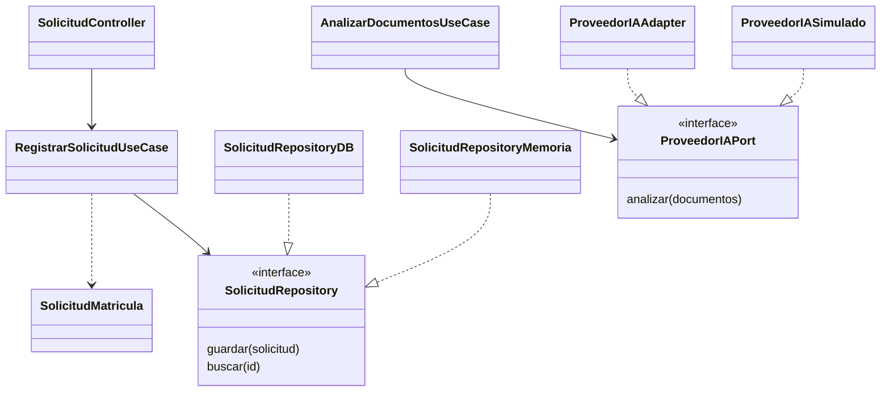

# Principios de diseño SOLID

> **Proyecto:** Sistema de matrícula y gestión académica para el colegio Mariscal Cáceres, Ayacucho.
> **Versión documental:** 1.0 · **Estado:** diseño académico propuesto, no implementado.

## 1. Objetivo

Aplicar SOLID a Matrícula y Validación Documental / IA para separar responsabilidades y facilitar cambios. Estos principios complementan Clean Architecture; su cumplimiento deberá verificarse cuando exista código.

## 2. Aplicación propuesta

| Principio y definición | Problema que evita | Aplicación y ejemplo | Beneficio arquitectónico |
|---|---|---|---|
| S: una clase tiene un motivo principal de cambio | Controladores que mezclan HTTP, negocio y SQL | `SolicitudController` recibe peticiones; `RegistrarSolicitudUseCase` coordina; `SolicitudMatricula` controla estados; `SolicitudRepositoryDB` persiste | Los cambios de interfaz o almacenamiento no obligan a modificar las reglas |
| O: extender mediante nuevos comportamientos sin modificar el núcleo estable | Condicionales por proveedor repartidos por el negocio | Un nuevo `ProveedorIAAdapter` implementa `ProveedorIAPort` y se conecta en composición | Se sustituye el proveedor conservando el caso de uso |
| L: una implementación debe respetar el contrato que sustituye | Adaptadores que devuelven formatos o errores incompatibles | Adaptador real y simulado devuelven campos, inconsistencias y estado de análisis con el mismo esquema; ambos distinguen error de resultado válido | Las sustituciones mantienen el comportamiento esperado; no basta compartir el nombre del método |
| I: interfaces pequeñas según la necesidad del consumidor | Dependencias innecesarias o permisos excesivos | `SolicitudRepository` guarda y busca; `AlmacenDocumentos` gestiona archivos; `ProveedorIAPort` analiza. IA no recibe métodos para confirmar matrícula | Se reducen acoplamiento y exposición de operaciones |
| D: la política de alto nivel depende de abstracciones | Casos de uso ligados a una base de datos o proveedor concreto | `RegistrarSolicitudUseCase` recibe `SolicitudRepository`; `AnalizarDocumentosUseCase` recibe `ProveedorIAPort` | Facilita pruebas con dobles y cambios tecnológicos sin alterar el núcleo |

## 3. Relaciones UML

Las dependencias apuntan a contratos y entidades; las implementaciones técnicas realizan esas interfaces. La composición conecta las clases concretas. El controlador y los casos de uso no seleccionan proveedores.

## 4. Relación con arquitectura y verificación futura

La separación de Clean Architecture favorece responsabilidad única. Repository y Adapter materializan inversión de dependencias; los contratos reducidos apoyan segregación de interfaces. Para abierto/cerrado y Liskov se deberán comprobar los contratos de éxito, error y tiempo de espera con cada adaptador.

Las pruebas unitarias propuestas comprobarían reglas de estados con repositorios en memoria. Las de integración comprobarían contratos reales y errores. Ninguna se ha ejecutado en esta entrega. La IA solo aporta observaciones: la resolución permanece en `ResolverSolicitudUseCase`, invocado por personal autorizado.

Referencias: [diseño interno](diseno-interno-de-modulos.md), [patrones](patrones-de-diseno.md) y [enfoque arquitectónico](../arquitectura/enfoque/enfoque-%20arquitectonico.md).
