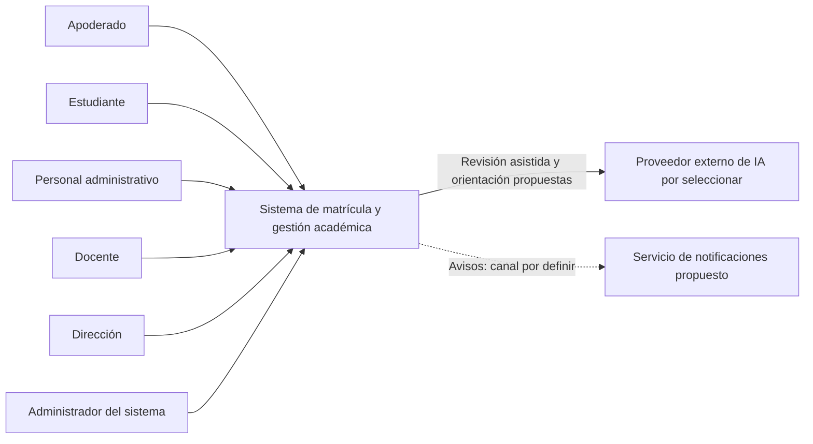

# Nivel 1: contexto del sistema

> **Proyecto:** Sistema de matrícula y gestión académica para el colegio Mariscal Cáceres, Ayacucho.
> **Modelo:** C4 · **Versión:** 1.0 · **Estado:** propuesta académica, no implementada.

## 1. Objetivo y alcance

Mostrar el sistema como una unidad, sus usuarios y servicios externos propuestos. La institución es una referencia académica; los procesos no han sido validados mediante trabajo de campo.

| Aspecto | Descripción |
|---|---|
| Pregunta | ¿Quién utiliza el sistema y con qué otros sistemas se relaciona? |
| Audiencia | Docente del curso, usuarios de referencia y equipo de desarrollo |
| Muestra | Actores, límite del sistema y relaciones externas |
| No muestra | Módulos, bases de datos, caché, servidores ni clases |

## 2. Diagrama

## 3. Personas

Se conservan los actores del [análisis existente](../analisis-de-sistema/01-actores.md), evitando reemplazarlos por perfiles nuevos.

| Actor | Participación propuesta |
|---|---|
| Apoderado | Datos propios y del estudiante vinculado, solicitudes, documentos, subsanación y consultas |
| Estudiante | Consulta autorizada de matrícula e información académica |
| Personal administrativo | Revisión documental, vacantes, observaciones y resolución de solicitudes; organización académica |
| Docente | Cursos asignados, calificaciones y observaciones; asistencia por confirmar |
| Dirección | Reportes y estadísticas autorizados |
| Administrador del sistema | Cuentas, roles, permisos y configuración |

## 4. Sistemas y relaciones

| Sistema | Tipo | Responsabilidad |
|---|---|---|
| Sistema de matrícula y gestión académica | En alcance, diseñado por el equipo | Digitalizar matrícula y organizar información académica |
| Proveedor IA | Externo propuesto | Extraer información y señalar posibles faltantes e inconsistencias; apoyar orientación RF26 si se confirma |
| Notificaciones | Externo propuesto, canal pendiente | Entregar avisos de observaciones y estados según RF06 |

| Origen | Destino | Relación |
|---|---|---|
| Seis actores | Sistema | Operaciones anteriores según rol y relación con el estudiante |
| Sistema | IA | Solicitar asistencia y recibir información estructurada preliminar |
| Sistema | Notificaciones | Solicitar avisos; mecanismo definitivo pendiente |

Los protocolos se detallan en el nivel 2. Las relaciones representan una propuesta, no integraciones operativas.

## 5. Decisiones reflejadas y supuestos

El alcance respeta RF01–RF26 sin desarrollar todas sus capacidades al mismo detalle. La aprobación pertenece al personal autorizado (RF12, ADR-004), nunca a la IA. Detectar inconsistencias no acredita autenticidad documental. No se enviarán documentos reales en demostraciones sin autorizaciones y salvaguardas correspondientes.

RENIEC permanece como posibilidad condicionada a acceso autorizado (RC11); no se representa como integración disponible. SIAGIE no se incorpora porque no se ha confirmado requisito ni acceso. La caída del proveedor IA permite continuar manualmente.

## 6. Pendientes y navegación

Confirmar permisos concretos, documentos exigidos, canal de avisos, proveedor IA (OpenRouter en evaluación), alcance del asistente y asistencia. El análisis previo contiene asistencia; la instrucción actual la deja opcional. No se elimina esa diferencia.

Siguiente: [nivel 2: contenedores](nivel2-contenedores.md). Alcance y discrepancias: [arquitectura inicial](../arquitectura/arquitectura-inicial.md). Registro original: [decisiones](../analisis-de-sistema/07-decisiones-arquitectonicas.md).
