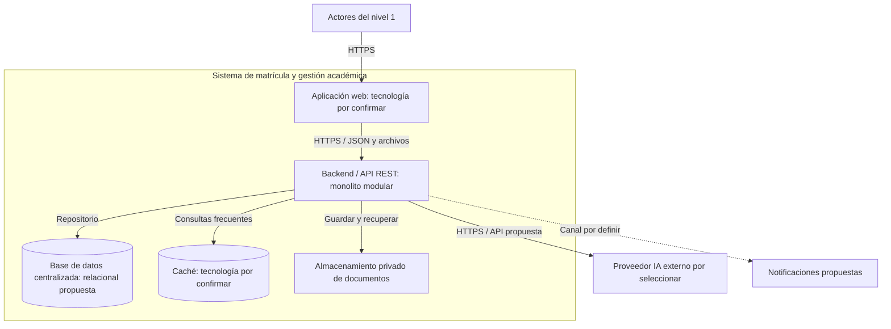

# Nivel 2: contenedores

> **Proyecto:** Sistema de matrícula y gestión académica para el colegio Mariscal Cáceres, Ayacucho.
> **Modelo:** C4 · **Versión:** 1.0 · **Estado:** diseño propuesto, no desplegado.

## 1. Objetivo

Abrir el sistema del nivel 1 para mostrar aplicaciones y almacenes de datos. Un contenedor C4 es una unidad ejecutable o de almacenamiento; no implica Docker.

| Aspecto | Descripción |
|---|---|
| Pregunta | ¿Qué aplicaciones y almacenes forman el sistema y cómo se comunican? |
| Audiencia | Equipo de desarrollo, arquitectura y operaciones |
| Muestra | Aplicación web, un backend y sus almacenes e integraciones |
| No muestra | Módulos internos, clases ni infraestructura ya instalada |

## 2. Diagrama

## 3. Contenedores e información

| Elemento | Responsabilidad e información | Tecnología y seguridad propuestas |
|---|---|---|
| Aplicación web | Formularios, estado de pantalla y consultas por rol | Framework por confirmar; HTTPS; sin secretos de proveedores |
| Backend/API | Casos de uso, permisos e integraciones | Lenguaje y framework por confirmar; una sola aplicación modular; autorización por rol y vínculo |
| Base de datos | Usuarios, estudiantes, solicitudes, matrículas, cupos e información académica | Relacional propuesta; PostgreSQL aparece en el avance previo como candidato, pendiente de selección compatible con Cloudflare; acceso restringido al backend |
| Caché | Copias temporales de requisitos configurados, grados y secciones | Redis es candidato del avance, no selección definitiva; sin documentos ni observaciones personales |
| Documentos privados | Adjuntos y constancias; referencias en base de datos | Almacenamiento privado por confirmar; acceso autorizado y temporal, sin enlaces públicos permanentes |
| Proveedor IA | Datos mínimos necesarios para análisis y resultado preliminar | Externo; OpenRouter en evaluación; claves solo en servidor, límites y validación de respuestas |
| Notificaciones | Datos mínimos para entregar avisos | Proveedor y canal por confirmar; sin incluir documentos sensibles en avisos |

IA y notificaciones son sistemas externos y no contenedores construidos por el equipo.

## 4. Relaciones y protocolos

| Origen | Destino | Comunicación propuesta |
|---|---|---|
| Actores | Web | HTTPS |
| Web | API | REST por HTTPS, JSON y transferencia de archivos; mecanismo de sesión por confirmar |
| API | Base de datos | Operaciones SQL mediante driver y canal protegido si se adopta base relacional; protocolo final depende del servicio |
| API | Caché | Cliente del almacén elegido en red restringida; Redis/TLS si se selecciona Redis |
| API | Documentos | API privada, normalmente HTTPS; contrato y proveedor por confirmar |
| API | IA | API sobre HTTPS propuesta; contrato depende de proveedor y modelo elegidos |
| API | Notificaciones | Contrato del canal seleccionado, pendiente |

## 5. Decisiones técnicas reflejadas

| Decisión conservada o propuesta | Justificación |
|---|---|
| Un backend modular (ADR-001) | Separar responsabilidades sin despliegues por módulo |
| Web y API REST (ADR-009) | Mantener separación cliente-servidor |
| Persistencia transaccional (ADR-005) | Confirmar cupo y evitar matrículas duplicadas |
| Caché de lecturas (ADR-003) | Reducir consultas repetidas; caducidad e invalidación por definir |
| Documentos privados y referencias | Separar archivos de datos estructurados y controlar su acceso |
| IA por adaptador (ADR-004) | Cambiar proveedor y permitir continuidad manual |
| Nube compatible con Cloudflare (ADR-010) | Respetar RC07; ubicación y compatibilidad concretas aún no verificadas |

La confirmación consulta y actualiza cupos en base de datos, nunca desde caché. El fallo de caché deriva a la base de datos; el de IA deja análisis pendiente. Se prevén tiempos de espera limitados y registros técnicos sin contenido documental sensible.

## 6. Calidad, seguridad y pendientes

Se proponen pruebas unitarias, integración, carga y confirmación concurrente; no se han ejecutado. Antes de una prueba debe aclararse si la referencia es 2.000 usuarios por hora o concurrentes, con operaciones, duración, datos y recursos definidos. No se puede convertir una cifra en otra sin un modelo de uso.

Escalar recursos o instancias requiere sesiones compatibles, repositorios y archivos compartidos. No se añaden microservicios. Deben definirse protección y retención de datos, copias y recuperación, permisos, formatos/tamaños de archivo, caducidad de caché, proveedor IA y validación de compatibilidad de nube. No se afirma soporte de un producto concreto.

Anterior: [contexto](nivel1-contexto-del-sistema.md). Siguiente: [componentes](nivel3-componentes.md). Véanse [estilo](../arquitectura/estilo-arquitectonico.md) y [decisiones originales](../analisis-de-sistema/07-decisiones-arquitectonicas.md).
