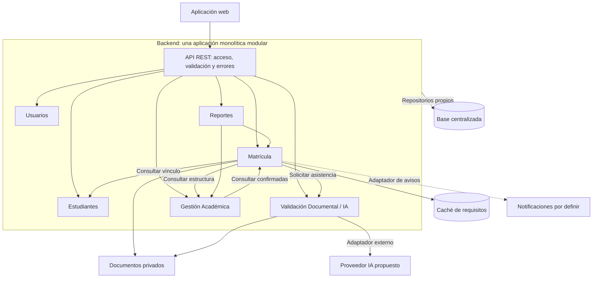

# Nivel 3: componentes

> **Proyecto:** Sistema de matrícula y gestión académica para el colegio Mariscal Cáceres, Ayacucho.
> **Modelo:** C4 · **Contenedor:** Backend/API REST · **Versión:** 1.0 · 

## 1. Objetivo

Describir los componentes internos del único backend del nivel 2. Se conserva la división de ADR-001, con Validación Documental como módulo que concentra las responsabilidades de IA. No se crean servicios ejecutables separados.

| Aspecto | Descripción |
|---|---|
| Pregunta | ¿Cómo se divide el backend y qué interfaces conectan sus módulos? |
| Audiencia | Arquitectura y desarrollo |
| Muestra | Entrada REST, módulos, relaciones internas y adaptadores externos |
| No muestra | Todas las clases, tablas o servidores |

## 2. Diagrama

Las flechas describen llamadas en ejecución. Las consultas entre Matrícula y Gestión Académica usan contratos pequeños y no crean un ciclo de importación de implementaciones: cada consumidor define el puerto que necesita y composición conecta adaptadores.

## 3. Componentes e interfaces públicas propuestas

| Componente | Responsabilidad y funciones | Interfaz pública y dependencias |
|---|---|---|
| API REST | Validar formato, autenticar, comprobar permisos y traducir errores | Rutas de solicitudes y consultas; invoca casos de uso y autorización de Usuarios |
| Usuarios | Identidad, cuentas, roles, permisos y parámetros generales (RF23–RF25) | AutorizarOperacion y ConsultarConfiguracion; repositorio propio |
| Estudiantes | Datos personales y vínculos estudiante-apoderado (RF01) | ConsultarEstudiante y VerificarVinculo; repositorio propio |
| Matrícula | Solicitudes, nuevos/continuadores, documentos, estados, cupos y constancias (RF02–RF13) | RegistrarSolicitud, RevisarSolicitud, ResolverSolicitud y ConsultarMatriculas; consume Estudiantes, estructura académica y revisión IA |
| Validación Documental / IA | Analizar documentos y validar resultados (RF10); orientación RF26 como capacidad por confirmar | AnalizarDocumentosUseCase como punto público; usa ProveedorIAPort y adaptador externo |
| Gestión Académica | Periodos, grados, secciones, cursos, docentes, asignaciones y registros académicos (RF14–RF21) | ConsultarEstructura y ConsultarInformacionAcademica; consume matrículas confirmadas. Asistencia pendiente |
| Reportes | Estadísticas y exportaciones autorizadas (RF22) | GenerarReporte; consulta interfaces públicas de Matrícula y Gestión Académica |

## 4. Relaciones

| Origen | Destino | Tipo y finalidad |
|---|---|---|
| Web | API | HTTPS/REST; formularios y consultas |
| API | Módulos | Llamada en memoria a casos de uso, con identidad autorizada |
| API | Usuarios | Llamada interna de autenticación/autorización; cada caso de uso conserva la comprobación de acceso a su recurso |
| Matrícula | Estudiantes | Llamada interna para comprobar vínculo y datos |
| Matrícula | Gestión Académica | Consulta interna de periodo, grado y sección |
| Gestión Académica | Matrícula | Consulta interna de matrículas confirmadas |
| Matrícula | Validación Documental / IA | Llamada por RevisionDocumentalAdapter a la API pública de análisis; no decide admisión |
| Reportes | Matrícula y Gestión Académica | Consultas internas autorizadas, sin SQL sobre tablas ajenas |
| Módulos persistentes | Base de datos | Mediante repositorios propios; tecnología por confirmar |
| Matrícula | Caché y documentos | Adaptadores de lectura y almacenamiento privado |
| Validación Documental / IA | Documentos y proveedor IA | Referencias autorizadas y contenido mínimo; llamada externa HTTPS propuesta |
| Matrícula | Notificaciones | Adaptador del canal pendiente |

## 5. Reglas y decisiones reflejadas

1. Todos los módulos pertenecen a una aplicación backend y se despliegan juntos.
2. Cada módulo tiene responsabilidad delimitada y API pública explícita.
3. La comunicación interna utiliza esas interfaces, sin importar clases privadas.
4. Cada módulo lee y escribe solo sus propias tablas.
5. Los proveedores externos se conectan mediante adaptadores.
6. El diseño interno respeta las dependencias de Clean Architecture.

Matrícula es el responsable propuesto de cupos y de la confirmación transaccional (ADR-005). Gestión Académica define estructura, sin modificar directamente cupos. El diseño concreta, sin trasladar ni reescribir, las [decisiones existentes](../analisis-de-sistema/07-decisiones-arquitectonicas.md).

La IA entrega campos y observaciones preliminares. Matrícula conserva el resultado validado; el personal autorizado decide. El fallo del proveedor deja análisis pendiente y permite revisión manual, sin perder la solicitud. El asistente RF26 no obtiene permisos para resolver solicitudes.

## 6. Pendientes y navegación

Confirmar límites de datos, contratos, transiciones de estado, requisitos institucionales, canal de avisos y alcance de asistencia y orientación. RENIEC no se añade como dependencia obligatoria: sigue condicionado a acceso autorizado. Tecnologías y despliegue no están confirmados.

Anterior: [contenedores](nivel2-contenedores.md). Siguiente: [código](nivel4-codigo.md). Complemento: [componentes generales](../arquitectura/componentes-arquitectonicos.md).
