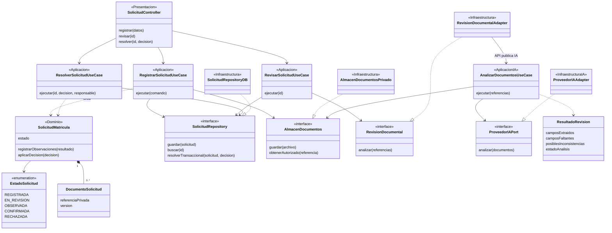

# Nivel 4: código

> **Proyecto:** Sistema de matrícula y gestión académica para el colegio Mariscal Cáceres, Ayacucho.
> **Modelo:** C4 · **Notación:** UML · **Versión:** 1.0 · 

## 1. Propósito y alcance

Detallar Matrícula y su colaboración con Validación Documental / IA, porque concentran el registro, los documentos, la revisión y la resolución. El nivel 4 se limita a este proceso; no pretende representar cada clase del sistema.

| Aspecto | Descripción |
|---|---|
| Pregunta | ¿Qué clases colaboran para registrar y revisar una solicitud? |
| Audiencia | Equipo de desarrollo y docente del curso |
| Muestra | Clases, contratos, adaptadores, estados y secuencia propuesta |
| No muestra | Implementación ejecutable, políticas institucionales aprobadas ni tecnologías definitivas |

## 2. Clases propuestas



Los estereotipos identifican áreas; las interfaces están en el Dominio del módulo consumidor. ResultadoRevision y ProveedorIAPort pertenecen a Validación Documental / IA. AlmacenDocumentos es un contrato mínimo compartido para acceso autorizado a archivos, sin compartir repositorios de solicitudes. El adaptador entre módulos utiliza exclusivamente la API pública de IA.

`-->` representa asociación o referencia, `..>` dependencia, `..|>` implementación de interfaz y `*--` composición. Los estados son propuestas sujetas a validación: REGISTRADA pasa a EN_REVISION; una decisión humana puede observar, confirmar o rechazar. Una subsanación devuelve la solicitud a revisión según reglas por acordar. El estado del análisis IA es independiente del estado administrativo.

## 3. Tabla de clases

| Nombre | Tipo | Área y módulo | Responsabilidad |
|---|---|---|---|
| SolicitudController | Controlador | Presentación / Matrícula | Traducir registro, revisión y resolución desde HTTP |
| RegistrarSolicitudUseCase | Caso de uso | Aplicación / Matrícula | Datos básicos, archivos privados y registro inicial |
| RevisarSolicitudUseCase | Caso de uso | Aplicación / Matrícula | Solicitar asistencia y conservar observaciones preliminares |
| ResolverSolicitudUseCase | Caso de uso | Aplicación / Matrícula | Comprobar autorización y ejecutar la decisión humana |
| SolicitudMatricula | Entidad | Dominio / Matrícula | Identidad, tipo nuevo/continuador, estado e historial |
| EstadoSolicitud | Enumeración | Dominio / Matrícula | Estados administrativos propuestos |
| DocumentoSolicitud | Objeto de valor | Dominio / Matrícula | Referencia privada y versión del archivo |
| SolicitudRepository | Interfaz | Dominio / Matrícula | Guardar, buscar y resolver atómicamente matrícula y cupo |
| AlmacenDocumentos | Interfaz | Dominio / contrato de archivos | Guardar y recuperar documentos autorizados |
| RevisionDocumental | Interfaz | Dominio / Matrícula | Obtener asistencia sin conocer el módulo proveedor |
| SolicitudRepositoryDB | Repositorio | Infraestructura / Matrícula | Persistencia, control de versión, unicidad y transacción de confirmación |
| AlmacenDocumentosPrivado | Adaptador | Infraestructura / archivos | Implementar el acceso privado al almacenamiento |
| RevisionDocumentalAdapter | Adaptador interno | Infraestructura / Matrícula | Traducir hacia la API pública de Validación Documental / IA |
| AnalizarDocumentosUseCase | Caso de uso público | Aplicación / IA | Recuperar archivos autorizados, analizar y validar estructura de salida |
| ProveedorIAPort | Interfaz | Dominio / IA | Contrato neutral de extracción y detección preliminar |
| ProveedorIAAdapter | Adaptador externo | Infraestructura / IA | Traducir API, limitar espera y normalizar errores |
| ResultadoRevision | Objeto de transferencia | Dominio / IA | Campos, faltantes, inconsistencias y estado; sin decisión de admisión |

La composición, omitida del diagrama para facilitar lectura, conecta implementaciones y contratos. Los permisos y vínculos se comprueban mediante Usuarios y Estudiantes antes de acceder al recurso, según C3; las clases internas de esos módulos quedan fuera del detalle.

## 4. Secuencia: registro, revisión y resolución

El registro y la revisión posterior son peticiones distintas. El diagrama abrevia controladores y casos de uso como Matrícula, y el caso de uso público y su adaptador como IA. La llamada externa tiene tiempo de espera y no mantiene abierta una transacción de base de datos.

```mermaid
sequenceDiagram
    actor A as Apoderado
    participant W as Aplicacion web
    participant M as Matricula
    participant F as Almacen privado
    participant R as SolicitudRepositoryDB
    actor P as Personal autorizado
    participant I as Validacion Documental / IA
    participant X as Proveedor IA propuesto
    A->>W: Registrar solicitud y documentos
    W->>M: POST solicitudes con identidad autenticada
    M->>M: Autorizar vinculo y validar datos y archivos
    alt Datos invalidos o acceso denegado
        M-->>W: Error controlado sin registrar
    else Entrada valida
        M->>F: Guardar documentos privados
        alt Fallo del almacenamiento
            F-->>M: Error
            M-->>W: Registro no completado
        else Archivos guardados
            F-->>M: Referencias privadas
            M->>R: Guardar solicitud, referencias e historial
            alt Fallo de persistencia
                R-->>M: Error
                M->>F: Solicitar limpieza de archivos sin referencia
                M-->>W: Error recuperable
            else Solicitud persistida
                R-->>M: Identificador y version
                M-->>W: 201 con estado REGISTRADA
            end
        end
    end
    Note over P,R: Revision posterior de una solicitud existente
    P->>M: Solicitar revision documental autorizada
    M->>R: Consultar solicitud y version documental
    R-->>M: Referencias y version
    opt Asistencia IA habilitada y procedente
        M->>I: Analizar referencias autorizadas
        I->>F: Recuperar contenido minimo autorizado
        F-->>I: Documentos de la version solicitada
        I->>X: Solicitar extraccion e inconsistencias
        alt Respuesta valida
            X-->>I: Informacion estructurada preliminar
            I->>I: Validar esquema y normalizar salida
            I-->>M: ResultadoRevision
            M->>R: Guardar observaciones preliminares y version
        else Fallo, demora o salida invalida
            I-->>M: Analisis pendiente o fallido
            M->>R: Registrar incidencia sin perder solicitud
        end
    end
    M-->>P: Documentos y observaciones para revision humana
    P->>M: Observar, confirmar o rechazar con motivo
    M->>M: Comprobar permiso, version y reglas configuradas
    M->>R: Resolver con historial y cupo si confirma
    alt Conflicto, duplicado o falta de vacante
        R-->>M: No confirmar; conservar estado consistente
        M-->>P: Informar conflicto para revision
    else Resolucion valida
        R-->>M: Estado e historial actualizados
        M-->>P: Resultado de decision humana
    end
```

| Relación | Finalidad |
|---|---|
| Apoderado → Web → Matrícula | Registrar información básica y adjuntos bajo identidad autorizada |
| Matrícula → Almacén y repositorio | Conservar documentos, referencias e historial; compensar fallos entre almacenes |
| Personal → Matrícula → IA | Iniciar asistencia sobre una versión documental concreta |
| IA → Proveedor | Extraer campos y detectar posibles inconsistencias con salida validada |
| Matrícula → Repositorio | Conservar resultados preliminares; rechazar resultados de una versión documental obsoleta |
| Personal → Matrícula → Repositorio | Resolver y actualizar estado; confirmar matrícula y cupo en una transacción |

Los errores de almacenamiento durante análisis también producen revisión pendiente y permiten continuar manualmente. Una salida con formato correcto puede contener errores de contenido: el personal debe contrastarla con los documentos. Las observaciones automáticas no cambian por sí solas el estado a OBSERVADA ni rechazan una solicitud.

## 5. Patrones, SOLID y decisiones reflejadas

| Elemento | Relación con el diseño |
|---|---|
| SolicitudRepository / SolicitudRepositoryDB | Repository; separa política y persistencia (ADR-002, ADR-005) |
| RevisionDocumentalAdapter / ProveedorIAAdapter | Adapter interno y externo; mantiene el proveedor fuera de Matrícula (ADR-004) |
| Inyección de contratos | Inversión de dependencias; casos de uso sin clases técnicas concretas |
| Controlador, entidad y casos de uso separados | Responsabilidad única |
| ProveedorIAPort reducido | Segregación de interfaces; no concede poder de admisión |
| Adaptadores sustituibles | Abierto/cerrado y Liskov, sujetos a los mismos contratos de resultado y error |

Decorator para consultas cacheadas se explica en [patrones](../03-diseno-de-software/patrones-de-diseno.md), fuera de este flujo de escritura. Las clases se corresponden con Matrícula y Validación Documental / IA de C3. No son evidencia de implementación.

## 6. Supuestos y pendientes

Confirmar campos obligatorios, documentos, tipos de archivo, transiciones, permisos, criterios de revisión, retención, idempotencia y limpieza de archivos. Definir tiempo de espera IA, validación de salida y contrato público, sin adjudicar capacidades a un proveedor aún no seleccionado. OpenRouter sigue en evaluación.

La aprobación es humana; no se verifica automáticamente autenticidad. Se propone control de versión para evitar que una revisión obsoleta sobrescriba una subsanación o decisión concurrente. La confirmación requiere requisitos configurados, unicidad por estudiante/periodo y cupo real en base de datos; el mecanismo concreto de bloqueo o actualización atómica queda por seleccionar.

Anterior: [componentes](nivel3-componentes.md). Este es el último nivel. Complementos: [diseño interno](../03-diseno-de-software/diseno-interno-de-modulos.md), [SOLID](../03-diseno-de-software/principios-de-diseno.md) y [decisiones originales](../analisis-de-sistema/07-decisiones-arquitectonicas.md).
