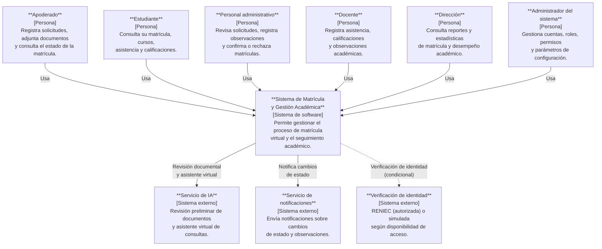
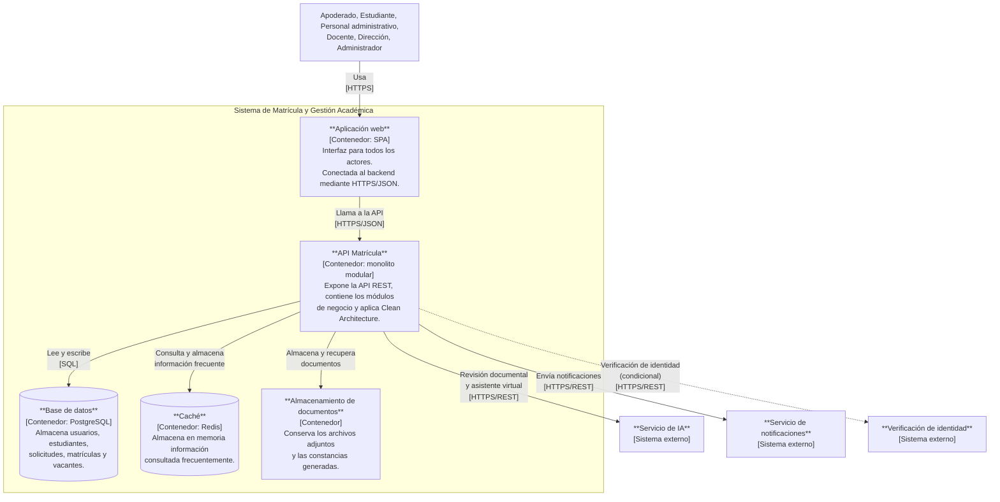
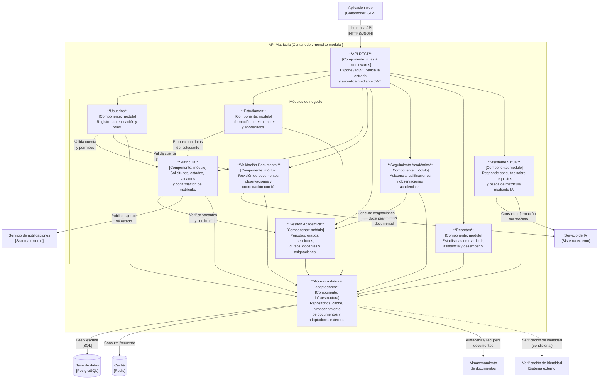

# Componentes arquitectónicos — Sistema de Matrícula y Gestión Académica

Modelo C4 · Estilo: monolito modular en capas

---

## Nivel 1 — Diagrama de contexto

Muestra quién interactúa con el sistema y con qué servicios externos se integra.

**Notas:**
- La línea discontinua hacia RENIEC indica una integración condicional: depende de contar con acceso autorizado. Si no se obtiene, el sistema utilizará un servicio simulado identificado como tal (RC11).
- Todos los actores acceden al sistema mediante un navegador web, sin necesidad de instalar una aplicación de escritorio (RC01).

---

## Nivel 2 — Diagrama de contenedores

Muestra los contenedores tecnológicos que componen el sistema y cómo se comunican.

**Notas:**
- El backend se despliega como una sola unidad (monolito modular); los módulos de negocio no se despliegan como servicios independientes.
- La caché almacena información de consulta frecuente como grados, secciones, requisitos documentales y vacantes disponibles, pero la confirmación de matrícula verifica el cupo directamente en la base de datos (ADR-003, ADR-005).
- El frontend se despliega en Cloudflare; la ubicación del backend, la base de datos y el almacenamiento se definirá según compatibilidad con los servicios seleccionados (RC07, ADR-010).

---

## Nivel 3 — Diagrama de componentes

Muestra los módulos internos del backend, sus responsabilidades y cómo se relacionan entre sí y con los sistemas externos.

**Notas:**
- Cada componente es un módulo del monolito: todos se despliegan juntos (ADR-001).
- Un módulo accede a otro solo a través de su interfaz pública (servicio), nunca directamente a sus tablas.
- La confirmación de matrícula verifica las vacantes en la base de datos dentro de una transacción, sin depender de la caché (ADR-005).
- La integración con IA es utilizada por Validación Documental (RF10) y por el Asistente Virtual (RF26). Si el servicio falla, Validación Documental conserva la solicitud y permite continuar mediante revisión administrativa (ADR-004, AC07).
- La línea discontinua hacia Verificación de identidad indica integración condicional (RC11).

---

## Resumen de contenedores y componentes

| Elemento | Tipo | Responsabilidad principal |
|---|---|---|
| Aplicación web | Contenedor (SPA) | Interfaz de usuario para todos los actores |
| API Matrícula | Contenedor (monolito modular) | Backend principal del sistema |
| Base de datos | Contenedor (PostgreSQL) | Persistencia de datos del sistema |
| Caché | Contenedor (Redis) | Consultas frecuentes de información no crítica |
| Almacenamiento de documentos | Contenedor | Archivos adjuntos y constancias generadas |
| Usuarios | Componente / módulo | Autenticación, roles y permisos |
| Estudiantes | Componente / módulo | Datos de estudiantes y apoderados |
| Matrícula | Componente / módulo | Solicitudes, estados, vacantes y confirmación |
| Validación Documental | Componente / módulo | Revisión de documentos con apoyo de IA |
| Gestión Académica | Componente / módulo | Periodos, grados, secciones, cursos y docentes |
| Seguimiento Académico | Componente / módulo | Asistencia, calificaciones y observaciones |
| Reportes | Componente / módulo | Estadísticas y exportaciones para la dirección |
| Asistente Virtual | Componente / módulo | Chatbot de consultas sobre el proceso de matrícula |
| Acceso a datos y adaptadores | Componente (infraestructura) | Repositorios, caché, documentos y adaptadores externos |
