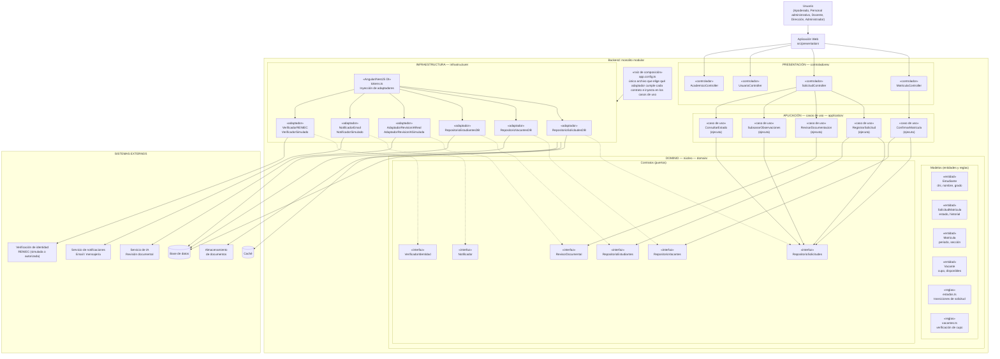

# Enfoque arquitectónico

## Clean Architecture

Se utiliza el enfoque Clean Architecture para separar las responsabilidades internas y controlar las dependencias del código.

| Elemento | Descripción aplicada al Sistema de Matrícula |
|---|---|
| **Patrón / enfoque arquitectónico** | Clean Architecture (Arquitectura Limpia). |
| **Objetivo** | Separar responsabilidades y controlar las dependencias hacia el dominio. |
| **¿Qué problema resuelve?** | Evita el acoplamiento entre la interfaz web, las reglas de matrícula y las tecnologías externas, como la base de datos, el servicio de IA y el servicio de notificaciones. |
| **Capas definidas** | Presentación, Aplicación, Dominio e Infraestructura. |
| **Beneficios** | • Facilita el mantenimiento y las pruebas unitarias.<br>• Permite cambiar implementaciones técnicas sin modificar innecesariamente las reglas de matrícula.<br>• Mejora la organización y separación de responsabilidades del código. |

---

## Responsabilidades de las capas

### Dominio
Contiene las entidades y las reglas del negocio, independientes de frameworks y servicios externos.

- **Entidades:** `Estudiante`, `SolicitudMatricula`, `Matricula`, `Vacante`.
- **Reglas:** condiciones para cambiar el estado de una solicitud, confirmar una matrícula, verificar documentos requeridos y validar observaciones pendientes.
- **Contratos (puertos):** interfaces de repositorios (`RepositorioSolicitudes`, `RepositorioVacantes`, `RepositorioEstudiantes`) y del servicio de IA (`RevisorDocumental`).
- No importa ninguna tecnología externa: ni framework web, ni base de datos, ni proveedor de IA.

### Aplicación
Coordina los casos de uso y define los contratos necesarios para acceder a datos y servicios externos.

- `RegistrarSolicitud`
- `AdjuntarDocumento`
- `SubsanarObservaciones`
- `RevisarDocumentacion`
- `ConfirmarMatricula`
- `ConsultarEstado`

### Presentación
Recibe las solicitudes del usuario y presenta los resultados.

- Componentes y pantallas de la aplicación web.
- Controladores de la API REST.
- Validación del formato de los datos recibidos.
- Respuestas y mensajes para el usuario.

### Infraestructura
Implementa los contratos definidos en el Dominio utilizando tecnologías concretas.

- Adaptadores de repositorios de base de datos.
- Almacenamiento de documentos adjuntos y constancias.
- Adaptador del proveedor de IA (`AdaptadorRevisionIAReal` / `AdaptadorRevisionIASimulada`).
- Implementación de caché para consultas frecuentes.
- Servicio de notificaciones (`NotificadorEmail` / `NotificadorSimulado`).
- Verificación de identidad (`VerificadorRENIEC` / `VerificadorSimulado`).

---

## Regla de dependencias

Las dependencias del código apuntan siempre hacia el núcleo del sistema:

1. El **Dominio** no importa nada de las capas externas.
2. Los **casos de uso** solo conocen entidades y contratos del Dominio.
3. Los **adaptadores** implementan los contratos del Dominio y son intercambiables.
4. Cambiar de tecnología implica modificar el adaptador correspondiente, no el Dominio ni los casos de uso.

La configuración de arranque conecta los casos de uso con los adaptadores concretos mediante inyección de dependencias.

---

## Diagrama de arquitectura — Clean Architecture aplicada al Sistema de Matrícula



**Leyenda:**
- `-->` Llamada en tiempo de ejecución / dependencia de código (apunta hacia el centro)
- `-.->` Implementa el contrato definido en el Dominio (inversión de dependencia)

**Reglas de dependencia:**
1. El Dominio no importa nada de las capas externas.
2. Los casos de uso solo conocen entidades y contratos.
3. Los adaptadores implementan contratos y son intercambiables.
4. Cambiar de tecnología = cambiar el adaptador en `app.config.ts`, no el Dominio.

---

## Ejemplo aplicado: confirmar matrícula

1. El controlador `MatriculaController` recibe la solicitud de confirmación.
2. El caso de uso `ConfirmarMatricula` coordina la operación.
3. Las reglas del Dominio verifican si la solicitud cumple las condiciones de matrícula.
4. El caso de uso utiliza `RepositorioVacantes` (interfaz) para verificar disponibilidad y asignar la vacante.
5. El repositorio de Infraestructura ejecuta la operación en una transacción, verificando el cupo y evitando duplicados.
6. El `Notificador` (interfaz) informa al apoderado sobre la confirmación.
7. La Presentación devuelve el resultado al usuario.

El caso de uso conoce el contrato del repositorio, pero no depende de una base de datos específica.

---

## Organización propuesta por módulo

```text
matricula/
├── dominio/
│   ├── entidades/
│   │   ├── Estudiante.ts
│   │   ├── SolicitudMatricula.ts
│   │   ├── Matricula.ts
│   │   └── Vacante.ts
│   ├── reglas/
│   │   ├── estados.ts
│   │   └── vacantes.ts
│   └── contratos/
│       ├── RepositorioSolicitudes.ts
│       ├── RepositorioVacantes.ts
│       ├── RevisorDocumental.ts
│       └── Notificador.ts
├── aplicacion/
│   └── casos-uso/
│       ├── RegistrarSolicitud.ts
│       ├── ConfirmarMatricula.ts
│       ├── RevisarDocumentacion.ts
│       ├── SubsanarObservaciones.ts
│       └── ConsultarEstado.ts
├── presentacion/
│   └── controladores/
│       ├── SolicitudController.ts
│       └── MatriculaController.ts
└── infraestructura/
    ├── repositorios/
    │   ├── RepositorioSolicitudesDB.ts
    │   └── RepositorioVacantesDB.ts
    ├── adaptadores/
    │   ├── AdaptadorRevisionIAReal.ts
    │   ├── AdaptadorRevisionIASimulada.ts
    │   ├── NotificadorEmail.ts
    │   └── VerificadorRENIEC.ts
    └── cache/
```

## Justificación

Clean Architecture permite modificar las reglas de matrícula, probar los casos de uso con implementaciones simuladas y sustituir servicios técnicos sin afectar el núcleo del negocio.

Por ejemplo:
- Cambiar el proveedor de IA requiere modificar únicamente `AdaptadorRevisionIAReal`, manteniendo el contrato `RevisorDocumental` que usa la Aplicación.
- Si la verificación de identidad con RENIEC no está disponible, se usa `VerificadorSimulado` sin modificar ningún caso de uso.
- La confirmación de matrícula puede probarse con `RepositorioVacantesMemoria` sin necesidad de una base de datos real.
