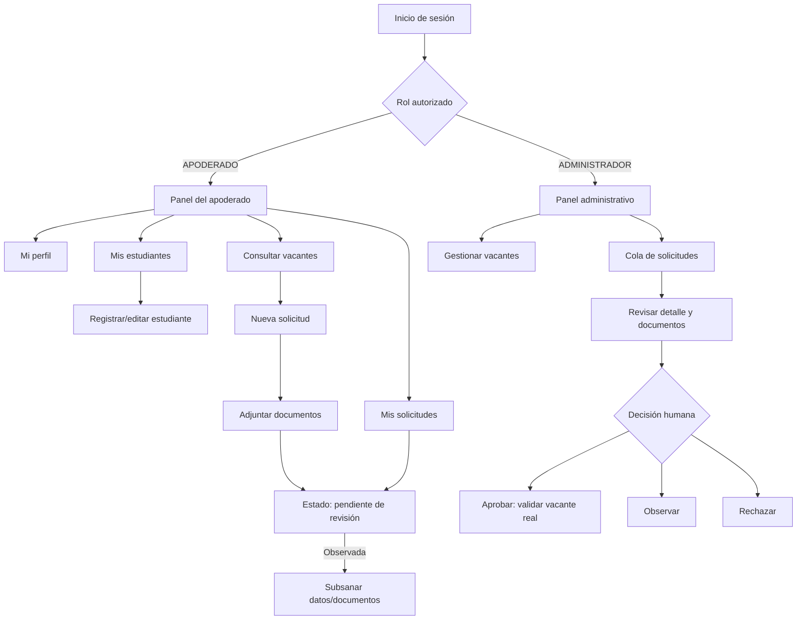

# Interfaces y navegación — Sprint 2

**Estado general:** DISEÑO FUNCIONAL DOCUMENTADO; INTERFAZ GRÁFICA NO IMPLEMENTADA.

Este documento describe la navegación y las vistas propuestas para el MVP del sistema. Durante el Sprint 2 se avanzó en el backend y en los contratos REST del módulo de matrícula, pero todavía no se han implementado pantallas, componentes visuales ni mockups.

Los roles `APODERADO` y `ADMINISTRADOR` se mantienen como propuestas de diseño sujetas a validación institucional.

## 1. Navegación propuesta por rol

El diagrama representa un flujo funcional propuesto, no una navegación ya disponible en el sistema.

## 2. Vistas propuestas para el MVP

| Vista | Actor propuesto | Contenido y acciones previstas | Estados vacíos y errores |
|---|---|---|---|
| Inicio de sesión | APODERADO / ADMINISTRADOR | Autenticación mediante Supabase Auth | Mensaje genérico de credenciales inválidas; recuperación de cuenta por definir |
| Panel del apoderado | APODERADO | Acceso a perfil, estudiantes, vacantes y solicitudes | Sin estudiantes o solicitudes: explicar la acción siguiente sin inventar políticas |
| Mi perfil | APODERADO / ADMINISTRADOR | Consultar y actualizar el perfil propio; no permitir modificar roles o identidad | Datos de perfil obligatorios pendientes de definición |
| Estudiantes | APODERADO; ADMINISTRADOR según autorización | Consultar estudiantes vinculados y registrar o editar información autorizada | Sin resultados y errores de permisos explícitos |
| Vacantes | APODERADO | Consultar y mostrar vacantes con el ano, nivel, grado y seccion devueltos por el backend | Sin disponibilidad: mostrar el estado devuelto por el servidor, sin prometer un cupo |
| Formulario de solicitud | APODERADO | Seleccionar estudiante e ingresar los datos requeridos para la solicitud | Validación por campo; borrador y guardado parcial por definir |
| Documentos | APODERADO vinculado / ADMINISTRADOR autorizado | Adjuntar, listar y consultar archivos privados | Mostrar progreso y errores de carga; formatos y límites aceptados pendientes |
| Detalle y estado de solicitud | APODERADO | Consultar estado, observaciones y acciones de subsanación cuando corresponda | Denegar el acceso a solicitudes ajenas sin revelar su contenido |
| Cola administrativa | ADMINISTRADOR | Consultar y filtrar solicitudes para su revisión | Sin resultados; filtros disponibles por confirmar |
| Revisión administrativa | ADMINISTRADOR | Revisar datos y documentos; observar, aprobar o rechazar solicitudes | Antes de aprobar, confirmar la validación de disponibilidad contra el servidor |
| Gestión de vacantes | ADMINISTRADOR | Consultar y actualizar la capacidad acordada | Mostrar errores de conflicto si la capacidad no concuerda con las matrículas |

Las acciones y permisos descritos son propuestas de interfaz. Su implementación requiere contratos de API, reglas institucionales confirmadas y controles de autorización en el backend.

## 3. Estado de implementación relacionado

| Elemento | Estado en Sprint 2 |
|---|---|
| Backend del módulo de matrícula | Implementado parcialmente; dispone de endpoints funcionales |
| Consulta de tipos de matrícula | Endpoint implementado |
| Consulta de vacantes | Endpoint implementado |
| Creación y consulta de solicitudes | Endpoints implementados |
| Revisión, observación, subsanación, aprobación y rechazo | Endpoints implementados |
| Autenticación mediante Supabase | Verificación de tokens configurada en backend; validación integral con usuarios reales pendiente |
| Pantallas de inicio de sesión y paneles | No implementadas |
| Gestión de perfiles y estudiantes desde la interfaz | No implementada |
| Adjuntar y consultar documentos desde la interfaz | No implementado |
| Gestión administrativa de vacantes desde la interfaz | No implementada |
| Frontend React y navegación | Pendiente de implementación |

La disponibilidad de un endpoint no implica que exista una pantalla que lo consuma. La documentación de los endpoints implementados se encuentra en `contratos-api.md` y en Swagger.

## 4. Reglas de interacción y accesibilidad

- La interfaz facilitará el uso del sistema, pero todas las reglas de autorización y validación deberán verificarse nuevamente en el backend.
- No se mostrará al apoderado información de solicitudes pertenecientes a otras personas.
- Los estados, observaciones y mensajes de error deberán expresarse en lenguaje claro. El catálogo y los textos definitivos quedan sujetos a validación.
- Se prevé utilizar React Hook Form y Zod para gestionar formularios y validaciones en el cliente. Estas validaciones no sustituirán las del backend.
- Se prevé utilizar React Router para la navegación y shadcn/ui para componentes visuales. Todavía no se han generado componentes ni pantallas.
- La interfaz deberá adaptarse a dispositivos móviles y computadoras.
- Antes de cerrar el diseño visual se deberán definir criterios de accesibilidad, adaptación móvil y retención de formularios.
- Las reglas institucionales sobre documentos, periodos, requisitos y procedimientos deberán confirmarse antes de convertir las vistas propuestas en funcionalidades definitivas.

## 5. Pendientes

1. Implementar la estructura inicial del frontend con React, Vite y TypeScript.
2. Desarrollar las pantallas de autenticación y navegación.
3. Integrar las vistas con los endpoints REST implementados.
4. Definir y validar los datos institucionales necesarios para formularios y documentos.
5. Implementar y probar el control de acceso desde la interfaz y el backend.
6. Realizar pruebas de usabilidad, accesibilidad y adaptación móvil.