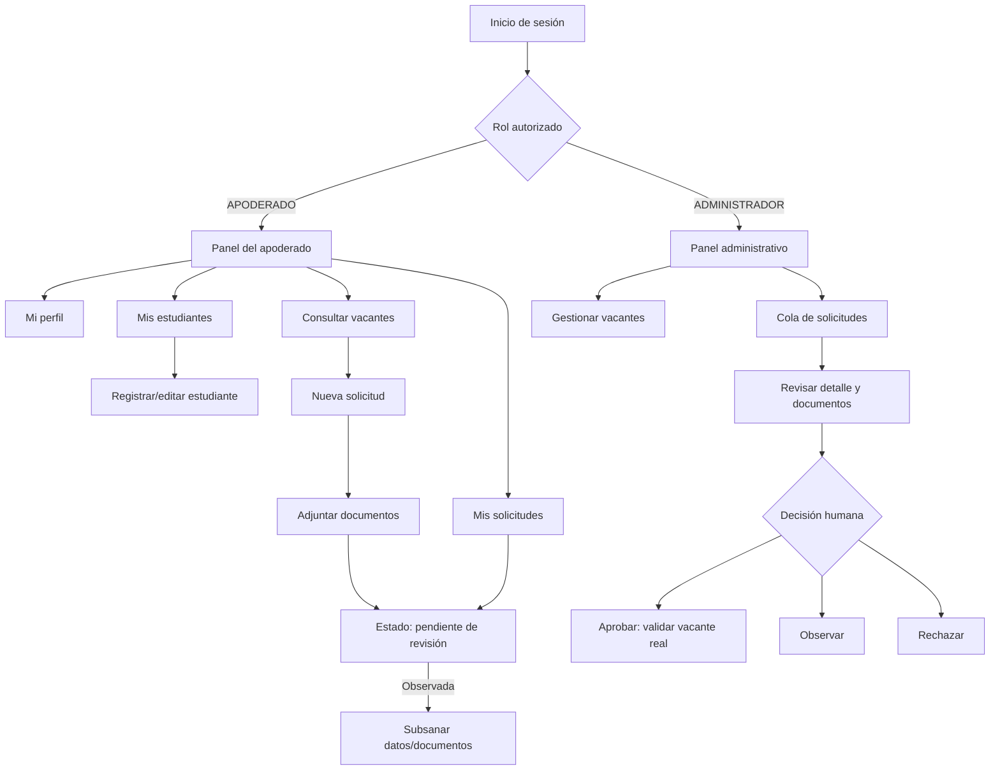

# Interfaces y navegación propuestas — Sprint 2

**Estado:** diseño funcional textual; no existen pantallas implementadas ni mockups.

## Navegación por rol

## Vistas del MVP

| Vista | Actor | Contenido/acciones | Estados vacíos/error |
|---|---|---|---|
| Inicio de sesión | APODERADO/ADMINISTRADOR | Autenticación prevista mediante Supabase Auth | Mensaje genérico de credencial inválida; recuperación por definir |
| Panel del apoderado | APODERADO | Acceso a perfil, estudiantes, vacantes y solicitudes | Sin estudiantes/solicitudes: explicar acción siguiente sin inventar política |
| Mi perfil | APODERADO/ADMINISTRADOR | Consultar/actualizar solo el perfil propio; nunca rol/identidad | Datos de perfil obligatorios pendientes |
| Estudiantes | APODERADO; ADMINISTRADOR solo en solicitud autorizada | Lista autorizada y registro/edición por apoderado vinculado | Sin resultados y errores de permiso explícitos |
| Vacantes | Apoderado | Consulta filtrada por grado/sección/periodo definidos | Sin disponibilidad: mostrar estado devuelto por servidor, sin prometer cupo |
| Formulario de solicitud | Apoderado | Seleccionar estudiante y datos de solicitud según contrato | Validación por campo; borrador/guardado parcial queda por definir |
| Documentos | APODERADO vinculado/ADMINISTRADOR en revisión autorizada | Adjuntar/listar/consultar archivos privados | Mostrar progreso/error de carga; formatos aceptados pendientes |
| Detalle/estado de solicitud | Apoderado | Estado, observaciones y acción de subsanar cuando corresponda | Denegar solicitud ajena sin mostrar contenido |
| Cola administrativa | ADMINISTRADOR | Filtrar y abrir solicitudes pendientes | Sin resultados; filtros disponibles por confirmar |
| Revisión administrativa | ADMINISTRADOR | Revisar datos/documentos y observar, aprobar o rechazar | Antes de aprobar mostrar confirmación de validación de cupo contra servidor |
| Gestión de vacantes | ADMINISTRADOR | Consultar y actualizar capacidad acordada | Errores de conflicto si capacidad y matrículas no concuerdan |

## Reglas de interacción y accesibilidad

- La UI mejora la experiencia, pero todas las reglas de autorización y validación se revalidan en backend.
- No se muestra al apoderado una solicitud perteneciente a otra persona.
- Estados, observaciones y errores deben expresarse en lenguaje claro; catálogo y textos finales por validar.
- Formularios previstos con React Hook Form y Zod una vez implementados; validación cliente no sustituye la del backend.
- Navegación prevista con React Router; no se han generado componentes ni secciones de shadcn/ui.
- Definir requisitos de accesibilidad, adaptación móvil y retención de formularios antes de cerrar diseño visual.
