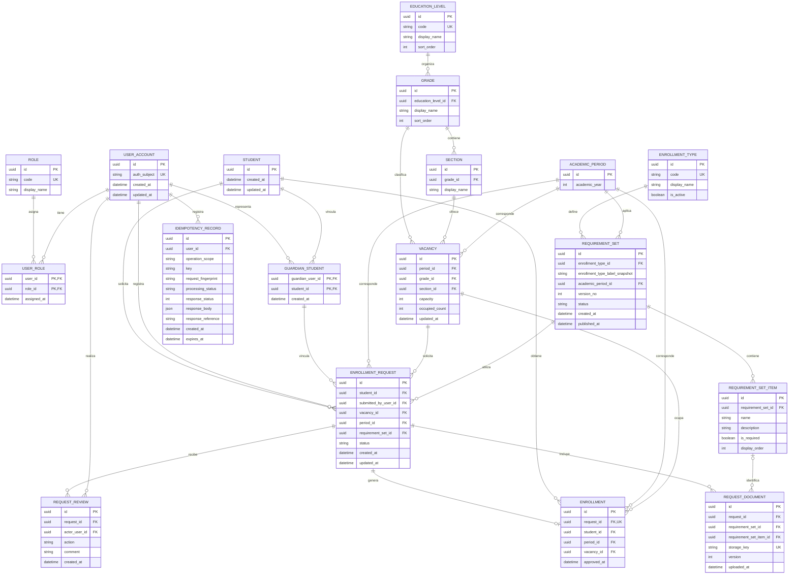

# Modelo de datos conceptual y lógico — Sprint 2

**Estado:** esquema Prisma actualizado y migración local del catálogo generada; pendiente de aplicación autorizada en la base de datos.

**Tecnologías:** PostgreSQL en Supabase y Prisma ORM 7.10.1.

Este documento describe el modelo de datos del sistema de matrícula. La implementación actual contiene 18 modelos Prisma y sus relaciones, orientados a autenticación y autorización, estructura académica, vinculación entre apoderados y estudiantes, consulta de vacantes, solicitudes, requisitos versionados, revisión y matrículas.

El esquema implementado representa la estructura técnica actual. Los atributos institucionales que todavía no han sido confirmados se mantienen fuera del modelo y deberán incorporarse cuando exista una definición validada por la institución.

Las restricciones, índices y reglas de integridad se identifican según su estado real: implementadas en el esquema o mediante migraciones SQL, o pendientes de implementación y validación.

## Diagrama entidad-relación



Las relaciones del diagrama representan las asociaciones principales entre las 18 entidades del modelo. Las claves foráneas compuestas se documentan por separado, ya que Mermaid ERD no permite representar completamente todas sus columnas y restricciones. En particular, `ENROLLMENT_REQUEST(submitted_by_user_id, student_id)` referencia el par `GUARDIAN_STUDENT(guardian_user_id, student_id)`, lo que garantiza que el apoderado que registra una solicitud tenga un vínculo registrado con el estudiante.

En el MVP documentado, la creación de solicitudes corresponde a un apoderado. Un eventual flujo de creación administrativa requeriría definir explícitamente otra regla de autorización y un ajuste del modelo; no se presume ni se habilita mediante esta estructura.

```

La migración local agrega el periodo académico 2027 y registra el catálogo confirmado de tres niveles y catorce grados. No crea filas de secciones, vacantes ni modifica registros existentes. La fecha de aplicación de esta migración queda pendiente de autorizació.

## Entidades, atributos y relaciones

La tabla describe las 18 entidades del modelo de datos implementado en Prisma y PostgreSQL. Los atributos técnicos corresponden al esquema Prisma actual; los datos institucionales todavía no definidos se identifican como pendientes de confirmación.

| Entidad | Atributos del esquema Prisma | PK/FK y cardinalidad | Datos pendientes y observaciones |
|---|---|---|---|
| `ROLE` | `id`, `code`, `displayName` | PK `id`; `code` único. Relación N:M con cuentas mediante `USER_ROLE`. | `APODERADO` y `ADMINISTRADOR` son roles iniciales propuestos, no una lista institucional definitiva. La gestión avanzada de roles y permisos está fuera del MVP. |
| `USER_ACCOUNT` | `id`, `authSubject`, `createdAt`, `updatedAt` | PK `id`; `authSubject` único. Relación N:M con roles mediante `USER_ROLE`. | Los atributos del perfil y el procedimiento de alta o vinculación institucional están pendientes de confirmación. No se almacenan contraseñas administradas por Supabase Auth. La validación integral con usuarios reales todavía está pendiente. |
| `USER_ROLE` | `userId`, `roleId`, `assignedAt` | PK compuesta (`userId`, `roleId`); FKs a `USER_ACCOUNT.id` y `ROLE.id`. Cada asignación enlaza una cuenta con un rol. | Quién asigna o modifica roles y bajo qué condiciones: `PENDIENTE_CONFIRMACION`. La gestión avanzada no forma parte del MVP. |
| `STUDENT` | `id`, `createdAt`, `updatedAt` | PK `id`. Puede tener varias solicitudes y varios vínculos con apoderados mediante `GUARDIAN_STUDENT`. | Datos personales, identificador institucional, campos obligatorios y reglas de unicidad: `PENDIENTE_CONFIRMACION`. |
| `GUARDIAN_STUDENT` | `guardianUserId`, `studentId`, `createdAt` | PK compuesta (`guardianUserId`, `studentId`); FKs a `USER_ACCOUNT.id` y `STUDENT.id`. Relación N:M con unicidad del par. | Quién verifica y crea el vínculo, así como la evidencia requerida: `PENDIENTE_CONFIRMACION`. El backend debe comprobar que la cuenta tenga autorización de apoderado. La vigencia temporal del vínculo requiere definición institucional y no puede determinarse con los campos actuales. |
| `ACADEMIC_PERIOD` | `id`, `academicYear` | PK `id`; `academicYear` identifica el año académico; relación 1:N con vacantes, solicitudes, conjuntos de requisitos y matrículas. | El modelo no agrega nombre, fechas ni estado del periodo porque no se han confirmado. |
| `ENROLLMENT_TYPE` | `id`, `code`, `displayName`, `isActive` | PK `id`; `code` único. Un tipo puede tener varios conjuntos de requisitos versionados por periodo. | Los nombres, códigos oficiales y criterios institucionales para clasificar cada tipo de matrícula están pendientes de confirmación. El catálogo es extensible y sus ejemplos no constituyen una lista cerrada. |
| `REQUIREMENT_SET` | `id`, `enrollmentTypeId`, `enrollmentTypeLabelSnapshot`, `academicPeriodId`, `versionNo`, `status`, `createdAt`, `publishedAt` | PK `id`; FKs a `ENROLLMENT_TYPE` y `ACADEMIC_PERIOD`. Contiene varios ítems y puede ser referenciado por solicitudes. | Los estados técnicos contemplados son `DRAFT`, `PUBLISHED` y `SUPERSEDED`. Existen restricciones de base de datos para proteger los conjuntos publicados o sustituidos. El contenido institucional, las fechas de vigencia y las reglas de publicación deben validarse. |
| `REQUIREMENT_SET_ITEM` | `id`, `requirementSetId`, `name`, `description`, `isRequired`, `displayOrder` | PK `id`; FK a `REQUIREMENT_SET`. La clave candidata compuesta permite validar su pertenencia al conjunto. | Tipos, nombres, descripciones y orden oficial de los documentos: `PENDIENTE_CONFIRMACION`. Una modificación de requisitos publicados debe generar una nueva versión, no una edición retroactiva. |
| `EDUCATION_LEVEL` | `id`, `code`, `displayName`, `sortOrder` | PK `id`; `code` único; relación 1:N con grados. | El catálogo confirmado contiene Inicial, Primaria y Secundaria; los niveles pueden ampliarse mediante nuevos registros. |
| `GRADE` | `id`, `educationLevelId`, `displayName`, `sortOrder` | PK `id`; FK a `EDUCATION_LEVEL.id`; unicidad de nombre y orden dentro del nivel; relación 1:N con secciones y vacantes. | Se registran 3 grados de Inicial (3, 4 y 5 años), 6 de Primaria (1.º–6.º grado) y 5 de Secundaria (1.º–5.º año). |
| `SECTION` | `id`, `gradeId`, `displayName` | PK `id`; FK `gradeId` → `GRADE.id`; unicidad compuesta (`id`, `gradeId`) para la integridad de vacantes. | No se insertan nombres ni registros de secciones; deben ser confirmados por la institución. |
| `VACANCY` | `id`, `periodId`, `gradeId`, `sectionId`, `capacity`, `occupiedCount`, `updatedAt` | PK `id`; FKs a periodo, grado y sección. Las relaciones compuestas conservan correspondencia entre grado, sección y periodo. | Capacidad y ocupación mantienen sus restricciones actuales; no se crean vacantes ni secciones. La unicidad por periodo y sección sigue pendiente de confirmación. |
| `ENROLLMENT_REQUEST` | `id`, `studentId`, `submittedByUserId`, `vacancyId`, `periodId`, `requirementSetId`, `status`, `createdAt`, `updatedAt` | PK `id`; FKs a estudiante, cuenta, vacante, periodo y conjunto de requisitos. Una FK compuesta garantiza que la cuenta que registra la solicitud tenga un vínculo con el estudiante. Conserva la versión de requisitos utilizada. | La fuente y regla para determinar el tipo de matrícula, así como la vigencia exacta de los requisitos dentro de un periodo: `PENDIENTE_CONFIRMACION`. No existe unicidad general de solicitudes por estudiante y periodo. |
| `REQUEST_DOCUMENT` | `id`, `requestId`, `requirementSetId`, `requirementSetItemId`, `storageKey`, `version`, `uploadedAt` | PK `id`; FK a solicitud y FK compuesta opcional al ítem del mismo conjunto. `storageKey` es único. | La asociación de archivos generales sin ítem, la cantidad de archivos por requisito y las políticas documentales requieren confirmación. La referencia al archivo es privada; el almacenamiento y su ciclo de vida deben validarse. |
| `REQUEST_REVIEW` | `id`, `requestId`, `actorUserId`, `action`, `comment`, `createdAt` | PK `id`; FKs a solicitud y cuenta que ejecuta el evento. Una solicitud puede tener varios eventos de revisión. | La obligatoriedad de comentarios y la política de retención están pendientes de confirmación. Las acciones y transiciones deben respetar el flujo definido por el backend. La idempotencia se registra en `IDEMPOTENCY_RECORD`, no en cada evento. |
| `ENROLLMENT` | `id`, `requestId`, `studentId`, `periodId`, `vacancyId`, `approvedAt` | PK `id`; `requestId` único; FKs a estudiante, periodo y vacante. Tiene unicidad por estudiante y periodo. Las FKs compuestas garantizan correspondencia con la solicitud y la vacante. | La restricción técnica evita matrículas duplicadas por estudiante y periodo. Su correspondencia con la política institucional debe confirmarse; el RF13 contempla evitar duplicidades. |
| `IDEMPOTENCY_RECORD` | `id`, `userId`, `operationScope`, `key`, `requestFingerprint`, `processingStatus`, `responseStatus`, `responseBody`, `responseReference`, `createdAt`, `expiresAt` | PK `id`; FK `userId` → `USER_ACCOUNT.id`; clave única (`userId`, `operationScope`, `key`). | Entidad técnica incorporada al modelo. La implementación completa de repetición segura, recuperación ante interrupciones y reproducción de respuestas está pendiente de validación. Retención, expiración y límites de respuesta: `PENDIENTE_DECISION_TECNICA`. No almacena tokens de autenticación ni archivos binarios. |

Los nombres de atributos se muestran en la convención de Prisma (`camelCase`); en PostgreSQL pueden utilizarse nombres físicos en `snake_case`, según el mapeo definido en el esquema. Las claves primarias, foráneas, restricciones únicas y controles de integridad descritos deben interpretarse junto con la sección de restricciones e índices. Los datos institucionales pendientes no deben convertirse en campos obligatorios ni reglas definitivas sin validación del colegio.

`IDEMPOTENCY_RECORD` es una entidad técnica incorporada al modelo de datos, no una entidad institucional ni una interfaz de administración. El ámbito identifica la operación y el recurso para evitar colisiones entre endpoints; la huella permite comparar los datos relevantes de solicitudes repetidas. La tabla contempla el almacenamiento del estado de procesamiento y del resultado asociado. No se almacena el token de autenticación ni el archivo binario.

Los estados técnicos previstos son `PROCESSING`, `COMPLETED` y `RETRYABLE_FAILURE`. La estrategia de reclamación, recuperación ante interrupciones, reproducción de respuestas y tratamiento de cargas debe completarse y validarse en el servicio. Para las operaciones que modifican PostgreSQL, se deberá garantizar la coherencia entre el registro de idempotencia y el efecto de negocio. La retención y expiración definitivas siguen pendientes de decisión técnica.

La aplicación debe validar las transiciones permitidas y la base de datos cuenta con restricciones para proteger los conjuntos de requisitos publicados o sustituidos frente a modificaciones y eliminaciones no permitidas. La resolución de versión y la creación de solicitudes, así como la publicación o sustitución de versiones, todavía requieren pruebas específicas de concurrencia para comprobar que cada solicitud quede vinculada íntegramente a una sola versión publicada.

## Restricciones e índices: estado de implementación

La siguiente tabla diferencia las restricciones incorporadas al esquema Prisma y a las migraciones SQL de aquellas que todavía requieren confirmación institucional o validación técnica. La existencia de una restricción en la base de datos no implica que todas las operaciones relacionadas hayan sido probadas bajo concurrencia.

| Restricción o índice | Aplicación | Estado | Justificación |
|---|---|---|---|
| PK UUID | Todas las entidades | Implementada | Proporciona una identidad técnica estable; no sustituye los identificadores institucionales que puedan definirse posteriormente. |
| FK con borrado restringido | Relaciones declaradas en el esquema | Implementada | Protege la integridad referencial y evita registros huérfanos. La política institucional de retención, eliminación y anonimización sigue pendiente de confirmación. |
| `UNIQUE(ROLE.code)` | `ROLE` | Implementada | Evita registrar códigos de rol duplicados. |
| `UNIQUE(EDUCATION_LEVEL.code)` | `EDUCATION_LEVEL` | Incluida en esquema y migracion local | Evita codigos de nivel duplicados. |
| `UNIQUE(education_level_id, display_name)` | `GRADE` | Incluida en esquema y migracion local | Evita nombres repetidos dentro del nivel. |
| `UNIQUE(education_level_id, sort_order)` | `GRADE` | Incluida en esquema y migracion local | Evita repetir el orden dentro del nivel. |
| FK (`education_level_id`) | `GRADE` -> `EDUCATION_LEVEL(id)` | Incluida en esquema y migracion local | Asocia cada grado a un nivel. |
| `UNIQUE(USER_ACCOUNT.auth_subject)` | `USER_ACCOUNT` | Implementada | Evita asociar una misma identidad externa a más de una cuenta local. |
| PK compuesta (`user_id`, `role_id`) | `USER_ROLE` | Implementada | Evita asignar dos veces el mismo rol a una cuenta y permite incorporar nuevos roles mediante el catálogo. |
| `UNIQUE(user_id, operation_scope, key)` | `IDEMPOTENCY_RECORD` | Restricción implementada; mecanismo pendiente | Evita duplicar una clave dentro del mismo usuario y ámbito de operación. La recuperación y reproducción segura de respuestas requieren implementación y pruebas adicionales. |
| PK compuesta (`guardian_user_id`, `student_id`) | `GUARDIAN_STUDENT` | Implementada | Evita repetir el mismo vínculo entre una cuenta y un estudiante. |
| `UNIQUE(period_id, section_id)` | `VACANCY` | Pendiente de confirmación institucional | Evitaría registrar más de una oferta para la misma sección y periodo, si esa es la regla definida por el colegio. |
| `UNIQUE(id, period_id)` | `VACANCY` | Implementada | Permite validar mediante una FK compuesta que la matrícula y la vacante correspondan al mismo periodo. |
| `UNIQUE(enrollment_type_id, academic_period_id, version_no)` | `REQUIREMENT_SET` | Implementada | Identifica inequívocamente cada versión de requisitos para un tipo y periodo académico. |
| `UNIQUE(id, academic_period_id)` | `REQUIREMENT_SET` | Implementada | Permite validar que la versión de requisitos referenciada por una solicitud corresponde al mismo periodo. |
| Índice único parcial (`enrollment_type_id`, `academic_period_id`) donde `status = 'PUBLISHED'` | `REQUIREMENT_SET` | Implementado mediante migración SQL | Mantiene como máximo una versión publicada por tipo y periodo. La sustitución de versiones debe respetar las reglas de publicación. |
| `UNIQUE(id, requirement_set_id)` | `REQUIREMENT_SET_ITEM` | Implementada | Permite comprobar que el ítem documental pertenece al conjunto de requisitos correspondiente. |
| `UNIQUE(id, grade_id)` | `SECTION` | Implementada | Permite validar que el grado asociado a una vacante coincide con el grado de su sección. |
| `UNIQUE(id, requirement_set_id)` | `ENROLLMENT_REQUEST` | Implementada | Permite validar que los documentos asociados pertenecen a la versión de requisitos fijada por la solicitud. |
| `UNIQUE(id, student_id, period_id)` | `ENROLLMENT_REQUEST` | Implementada | Proporciona una clave candidata para comprobar que la matrícula resultante corresponde al mismo estudiante y periodo de la solicitud. No impone unicidad de solicitudes por estudiante y periodo. |
| `CHECK(capacity >= 0)` y `CHECK(0 <= occupied_count AND occupied_count <= capacity)` | `VACANCY` | Implementados mediante migraciones SQL | Mantienen la capacidad y la ocupación dentro de rangos válidos. |
| `UNIQUE(request_id)` | `ENROLLMENT` | Implementada | Impide que una misma solicitud genere más de una matrícula. |
| `UNIQUE(student_id, period_id)` | `ENROLLMENT` | Implementada | Evita registrar más de una matrícula para el mismo estudiante en un periodo, conforme a la regla técnica asociada al RF13. Su correspondencia con la política institucional debe confirmarse. |
| FK compuesta (`submitted_by_user_id`, `student_id`) | `ENROLLMENT_REQUEST` → `GUARDIAN_STUDENT(guardian_user_id, student_id)` | Implementada | Impide persistir una solicitud si la cuenta que la registra no tiene un vínculo registrado con el estudiante. La vigencia temporal del vínculo requiere una definición institucional adicional. |
| FK compuesta (`vacancy_id`, `period_id`) | `ENROLLMENT_REQUEST` → `VACANCY(id, period_id)` | Implementada | Garantiza que el periodo de la solicitud coincida con el periodo de la vacante. |
| FK compuesta (`requirement_set_id`, `period_id`) | `ENROLLMENT_REQUEST` → `REQUIREMENT_SET(id, academic_period_id)` | Implementada | Garantiza que la versión de requisitos fijada corresponda al periodo de la solicitud. |
| FK compuesta (`request_id`, `requirement_set_id`) | `REQUEST_DOCUMENT` → `ENROLLMENT_REQUEST(id, requirement_set_id)` | Implementada | Garantiza que el conjunto declarado por el documento sea el fijado en su solicitud. |
| FK compuesta (`requirement_set_item_id`, `requirement_set_id`) | `REQUEST_DOCUMENT` → `REQUIREMENT_SET_ITEM(id, requirement_set_id)` | Implementada | Cuando se asigna un ítem, garantiza que pertenezca al mismo conjunto de requisitos. La asociación opcional permite documentos generales si la aplicación los admite. |
| Índice (`student_id`, `created_at`) | `ENROLLMENT_REQUEST` | Implementado | Facilita listar las solicitudes de un estudiante ordenadas por fecha. |
| Índice (`status`, `created_at`) | `ENROLLMENT_REQUEST` | Implementado | Facilita consultar la cola administrativa por estado y fecha. |
| Índice (`request_id`, `uploaded_at`) | `REQUEST_DOCUMENT` | Implementado | Facilita recuperar los documentos de una solicitud por fecha de carga. |
| Índice (`request_id`, `created_at`) | `REQUEST_REVIEW` | Implementado | Facilita recuperar el historial de revisiones de una solicitud. |
| FK compuesta (`section_id`, `grade_id`) | `VACANCY` → `SECTION(id, grade_id)` | Implementada | Impide registrar una vacante cuyo grado no corresponda al grado de su sección. |
| FK compuesta (`vacancy_id`, `period_id`) | `ENROLLMENT` → `VACANCY(id, period_id)` | Implementada | Impide que una matrícula se asocie a una vacante de otro periodo. |
| FK compuesta (`request_id`, `student_id`, `period_id`) | `ENROLLMENT` → `ENROLLMENT_REQUEST(id, student_id, period_id)` | Implementada | Impide asociar la matrícula a una solicitud, estudiante o periodo distintos. |
| Índice (`period_id`, `grade_id`, `section_id`) | `VACANCY` | Implementado | Facilita filtrar vacantes por periodo, grado y sección. |

Los índices implementados todavía deben evaluarse mediante planes de consulta y datos representativos para comprobar su utilidad y rendimiento. La restricción única por periodo y sección permanece pendiente de confirmación institucional. Asimismo, la idempotencia, la concurrencia sobre la última vacante y las operaciones de publicación o sustitución de versiones requieren pruebas específicas. No se define borrado en cascada para datos personales o documentos; las políticas de retención y anonimización permanecen como `PENDIENTE_CONFIRMACION`.

## Aprobación concurrente de vacante

### Contador almacenado frente a conteo de matrículas

| Estrategia | Ventaja | Riesgo |
|---|---|---|
| Contar filas `ENROLLMENT` | Evita almacenar un dato derivado de las matrículas. | Sin sincronización, dos transacciones pueden leer la misma disponibilidad y aprobar más matrículas que las permitidas. Se requiere bloquear una fila estable de `VACANCY` o aplicar una operación atómica equivalente. |
| Contador `VACANCY.occupied_count` | Permite consultar y actualizar la ocupación directamente sobre la fila de la vacante. | Puede desincronizarse si existen escrituras fuera de la transacción que registra las matrículas. Requiere restricciones y mecanismos de reconciliación. |

**Estrategia adoptada en el modelo:** se utiliza el contador almacenado `VACANCY.occupied_count`. Las restricciones de capacidad y ocupación se encuentran implementadas en las migraciones de PostgreSQL. El flujo de aprobación también fue ejecutado funcionalmente y se comprobó el incremento del contador.

Sin embargo, todavía está pendiente implementar y validar la protección frente a aprobaciones concurrentes. También se propone incorporar una consulta de reconciliación que compare el contador con las matrículas registradas.

### Estrategia PostgreSQL y aislamiento

| Alternativa | Garantía y evaluación |
|---|---|
| `SELECT ... FOR UPDATE` sobre la fila de `VACANCY` en `READ COMMITTED` | Serializa las operaciones que compiten por la misma vacante. Una transacción espera a que termine la anterior antes de evaluar nuevamente la disponibilidad. Requiere mantener el bloqueo durante la verificación, el incremento y el registro de la matrícula. |
| `UPDATE VACANCY SET occupied_count = occupied_count + 1 WHERE id = $1 AND occupied_count < capacity RETURNING ...` | Realiza un incremento condicional atómico. Si no retorna filas, no existe capacidad disponible y la operación no debe continuar. Debe ejecutarse dentro de la misma transacción que registra la matrícula y actualiza la solicitud. |
| Aislamiento `SERIALIZABLE` | Permite detectar conflictos de serialización, pero puede abortar transacciones bajo contención. Requiere implementar reintentos de la transacción completa. |
| `COUNT(*)` de matrículas sin bloqueo ni actualización condicional | Es insuficiente para evitar sobreasignaciones, porque dos transacciones pueden leer simultáneamente la misma disponibilidad. |

**Estrategia técnica propuesta para completar la protección:** utilizar transacciones PostgreSQL con aislamiento `READ COMMITTED`, controlar la transición de estado de la solicitud y consumir la vacante mediante un incremento condicional. El registro de la matrícula, el incremento de `occupied_count` y la actualización del estado deben confirmarse o revertirse como una sola unidad de trabajo.

Las restricciones únicas de `ENROLLMENT` constituyen una protección adicional frente a matrículas duplicadas, pero no sustituyen la protección del cupo disponible.

**Estado de implementación y validación:**

- Contador `VACANCY.occupied_count`: implementado.
- Restricciones de capacidad y ocupación: implementadas mediante migraciones.
- Flujo funcional de aprobación e incremento del contador: ejecutado y comprobado.
- Protección frente a aprobaciones concurrentes por la última vacante: pendiente de implementación y prueba.
- Reconciliación entre el contador y las matrículas: propuesta pendiente.
- Prueba concurrente de dos o más aprobaciones para una sola vacante disponible: pendiente.

La estrategia definitiva deberá verificarse con la API transaccional de Prisma y el servicio PostgreSQL utilizado en Supabase.

### Orden transaccional propuesto

La autenticación del actor se realiza antes de iniciar el trabajo de dominio. La autorización del recurso y la validación del estado deben comprobarse en el backend. Para completar la protección transaccional de la aprobación se propone el siguiente orden:

1. Iniciar una transacción de base de datos.
2. Bloquear la fila de `ENROLLMENT_REQUEST` correspondiente y volver a comprobar su estado, estudiante y vacante. La solicitud debe encontrarse en `EN_REVISION` y el actor debe estar autorizado para resolverla.
3. Bloquear la fila de `VACANCY` asociada a la solicitud. Las operaciones que modifiquen solicitudes y vacantes deberán respetar un orden global de bloqueo para reducir el riesgo de interbloqueos.
4. Leer la capacidad y ocupación actuales desde PostgreSQL. La caché no debe utilizarse para decidir si una aprobación puede consumir la última vacante.
5. Reclamar o comprobar la clave de idempotencia dentro de la operación. Si ya existe una operación completada con la misma huella, se debe reproducir su respuesta sin repetir el efecto. Si la huella es diferente, se debe devolver un conflicto.
6. Comprobar que no exista una matrícula duplicada para la solicitud ni para el estudiante y periodo correspondientes. Incrementar `occupied_count` mediante una actualización condicional que compruebe que todavía existe capacidad.
7. Insertar la matrícula, registrar el evento de aprobación con el actor correspondiente, actualizar el estado de la solicitud y guardar el resultado idempotente.
8. Confirmar la transacción. Si algún paso falla, las modificaciones realizadas dentro de ella deben revertirse conjuntamente.

Con esta estrategia, dos solicitudes distintas que compitan por la última vacante se serializarían sobre la misma fila de `VACANCY`. La primera operación que consuma la capacidad podrá continuar; la segunda deberá detectar que ya no existe disponibilidad y no podrá generar una matrícula.

Si dos solicitudes de un mismo estudiante compiten por vacantes diferentes del mismo periodo, la restricción única de `ENROLLMENT` para estudiante y periodo actuará como protección adicional. El incremento de ocupación de la operación que no pueda registrar la matrícula deberá revertirse junto con el resto de su transacción.

**Estado actual:** el flujo funcional de aprobación, el registro de matrícula y el incremento del contador fueron ejecutados y comprobados. El bloqueo explícito de filas, la actualización condicional y las pruebas de concurrencia descritas en este apartado son propuestas pendientes de implementación y validación.

### Conflictos, reintentos e idempotencia

Se proponen las siguientes reglas para completar la gestión de conflictos y operaciones repetidas:

- La falta de capacidad, una solicitud que no pueda resolverse en su estado actual o una matrícula duplicada deben tratarse como conflictos de negocio. Se propone utilizar HTTP `409 Conflict` para estos casos.
- Los conflictos de negocio definitivos no deben provocar reintentos automáticos. Si cambia la condición que originó el conflicto, el cliente deberá iniciar una nueva operación.
- PostgreSQL puede abortar transacciones por interbloqueos (`40P01`) o por errores de serialización (`40001`, cuando se utilice aislamiento `SERIALIZABLE`). Ante estos errores transitorios se propone reintentar la transacción completa, con un límite de intentos, backoff y jitter por definir.
- En cada intento deben volver a comprobarse el estado de la solicitud, la disponibilidad de la vacante y los permisos del actor. No deben reutilizarse datos obtenidos en una transacción abortada.
- La tabla `IDEMPOTENCY_RECORD` ya está definida en el modelo y cuenta con una restricción única sobre (`user_id`, `operation_scope`, `key`). Almacena la huella de la solicitud, el estado de procesamiento, la respuesta y las fechas correspondientes. Sin embargo, el mecanismo que utiliza esta tabla para evitar efectos duplicados está pendiente de implementación.
- Se propone que una misma clave, usuario, ámbito y huella reproduzcan la respuesta original. Si se reutiliza la misma clave y contexto con una huella diferente, se devolverá `409 IDEMPOTENCY_KEY_REUSED`.
- La reclamación de una clave debe ser atómica. Una operación que ya se encuentre en procesamiento no debe ejecutarse nuevamente en paralelo. Se propone devolver `409 IDEMPOTENCY_IN_PROGRESS` o esperar su resolución, según la estrategia que se implemente.
- Para operaciones cuyos efectos se limitan a PostgreSQL, el registro idempotente, los cambios de negocio y la respuesta deben confirmarse en una misma transacción. Un rollback no debe dejar registrada una operación como completada.
- Los resultados definitivos de negocio podrán almacenarse y reproducirse como resultados terminales de la clave. Los errores transitorios no deberán registrarse como resultados definitivos y podrán dar lugar a un nuevo intento seguro.
- Si la respuesta se pierde después de confirmar la transacción, una repetición con la misma clave deberá devolver el resultado original, sin repetir los efectos.
- Las restricciones únicas de la base de datos seguirán siendo una protección adicional frente a duplicidades, pero no reemplazan el mecanismo de idempotencia.
- La retención y expiración de las claves, así como el tratamiento de claves expiradas, quedan pendientes de definición.

**Operaciones con documentos:** PostgreSQL y un servicio externo de almacenamiento privado no comparten una misma transacción. Para una futura integración se propone utilizar un proceso de reclamación, carga del objeto, confirmación de metadatos y recuperación de operaciones incompletas. También deberá definirse una estrategia de compensación para eliminar objetos cargados cuando falle el registro de sus metadatos. Esta integración y sus pruebas quedan pendientes de seleccionar y validar el proveedor de almacenamiento.

**Estado de implementación:**

- Modelo `IDEMPOTENCY_RECORD` y restricción única: implementados en la base de datos.
- Mecanismo completo de reclamación, reproducción de respuestas y control de duplicados: pendiente.
- Reintentos automáticos de transacciones por errores transitorios: pendiente.
- Uso obligatorio de `Idempotency-Key` en todas las mutaciones REST: pendiente.
- Integración con almacenamiento privado y recuperación de operaciones incompletas: pendiente.

## Estados

Los valores propuestos para `ENROLLMENT_REQUEST.status` son:

- `PENDIENTE`
- `EN_REVISION`
- `OBSERVADA`
- `APROBADA`
- `RECHAZADA`

La definición y la tabla de transiciones se encuentran en [Revisión y resolución](funcionalidades/05-revision-y-resolucion.md).

Estos estados se encuentran contemplados en el modelo y en las operaciones implementadas del flujo de solicitudes. Su definición como reglas institucionales continúa con estado `PENDIENTE_CONFIRMACION`. La IA no decide ni modifica estados en el Sprint 2.
