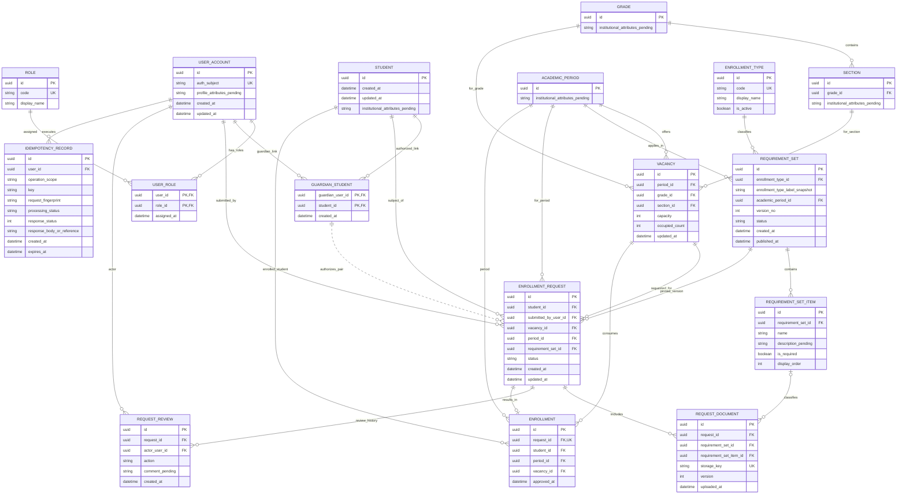

# Modelo de datos conceptual y lógico — Sprint 2

**Estado:** diseño propuesto, pendiente de validación institucional y de implementación.  
**Tecnologías previstas:** PostgreSQL en Supabase, acceso mediante Prisma.

Este modelo mínimo permite autenticación/autorización básica, relación apoderado-estudiante, consulta de vacantes, solicitud con requisitos versionados, revisión humana y matrícula. No es un schema Prisma ni una migración ejecutable. Los atributos marcados `PENDIENTE_CONFIRMACION` dependen de la institución y no deben convertirse en campos obligatorios sin aprobación.

## Diagrama entidad-relación

Las relaciones punteadas del diagrama representan invariantes de integridad compuesta, no una relación adicional independiente. En particular, `ENROLLMENT_REQUEST(submitted_by_user_id, student_id)` referencia el par `GUARDIAN_STUDENT(guardian_user_id, student_id)`. Las líneas individuales entre solicitud/cuenta y solicitud/estudiante muestran sus referencias y cardinalidades, pero **no sustituyen** esta FK compuesta. En el MVP documentado toda creación de solicitud la realiza un apoderado, por lo que la restricción aplica a cada fila. Un eventual flujo de creación administrativa requeriría una regla/modelado explícitos y no se presume ni habilita aquí.

`ENROLLMENT_TYPE` es un catálogo extensible y no un enum cerrado: los ejemplos de situaciones no se insertan como valores confirmados. Una vez usado, el código y significado de un tipo no se cambian retroactivamente; para una categoría semánticamente nueva se registra otro tipo y se desactiva el anterior si corresponde. Cada `REQUIREMENT_SET` pertenece a un tipo y periodo académico y tiene versión/estado de publicación, además de copiar la etiqueta del tipo. Sus `REQUIREMENT_SET_ITEM` contienen la definición documental y si es obligatoria. Se elige esta estructura de tres entidades en vez de una definición global reutilizable: los nombres y obligatoriedad quedan versionados dentro del conjunto y no cambian retroactivamente por editar un catálogo compartido. Una solicitud conserva `requirement_set_id`; sus documentos se asocian opcionalmente a un elemento de esa misma versión, con FK compuesta. El backend resuelve la versión publicada aplicable; el cliente no elige el conjunto ni su lista de requisitos.

El diagrama muestra cardinalidades conceptuales. `APODERADO` y `ADMINISTRADOR` son los dos códigos iniciales propuestos, no una lista institucional definitiva. `ROLE` y `USER_ROLE` permiten agregar otros roles o asignar varios roles a una cuenta sin cambiar la estructura relacional; la autorización se amplía agregando políticas de backend, no con una enumeración cerrada de roles. `auth_subject` enlaza la cuenta local con la identidad gestionada por Supabase Auth. Si la identidad se resuelve sin tabla local, la necesidad exacta de `USER_ACCOUNT` debe confirmarse antes de migrar.

La solicitud conserva `period_id` junto a `vacancy_id` como clave de integridad redundante: FKs compuestas garantizan que la vacante y la versión de requisitos pertenecen al mismo periodo. Esto evita depender solo de una comprobación de aplicación para esa correspondencia. La matrícula guarda también `period_id` para unicidad estudiante/periodo y usa FKs compuestas con la solicitud y la vacante. Las restricciones compuestas forman parte del modelo lógico, aunque Mermaid ERD no dibuja las columnas que forman cada FK.

## Entidades, atributos y relaciones

| Entidad | Atributos conocidos/propuestos | PK/FK y cardinalidad | Datos pendientes |
|---|---|---|---|
| `ROLE` | `id`, `code`, `display_name` | PK `id`; `code` único. Relación N:M con cuentas mediante `USER_ROLE`. | `APODERADO` y `ADMINISTRADOR` son roles iniciales propuestos, no confirmación institucional. Alta de roles/permisos avanzados fuera del MVP. |
| `USER_ACCOUNT` | `id`, `auth_subject`, fechas; perfil propio pendiente | PK `id`; `auth_subject` único. Relación N:M con roles mediante `USER_ROLE`. | Atributos del perfil, alta/provisionamiento e identidad institucional: `PENDIENTE_CONFIRMACION`. No guardar contraseñas administradas por Supabase Auth. |
| `USER_ROLE` | `user_id`, `role_id`, `assigned_at` | PK compuesta (`user_id`,`role_id`); FKs a `USER_ACCOUNT.id` y `ROLE.id`. Cada asignación enlaza una cuenta con un rol. | Quién asigna/cambia roles y condiciones de asignación: `PENDIENTE_CONFIRMACION`; la gestión avanzada no forma parte del MVP. |
| `STUDENT` | `id`, fechas de auditoría; demás atributos no conocidos | PK `id`. Puede tener varias solicitudes y varios apoderados mediante `GUARDIAN_STUDENT`. | Datos personales, identificador institucional, campos obligatorios y unicidad: `PENDIENTE_CONFIRMACION`. |
| `GUARDIAN_STUDENT` | `guardian_user_id`, `student_id`, `created_at` | PK compuesta; FKs a `USER_ACCOUNT.id` y `STUDENT.id`. Relación N:M con unicidad del par. | Quién verifica/crea el vínculo y evidencia: `PENDIENTE_CONFIRMACION`. Restringir `guardian_user_id` a rol APODERADO en servicio/constraint. La vigencia temporal del vínculo no puede determinarse solo con los campos actuales; regla, atributo y origen de esa vigencia requieren confirmación institucional. |
| `ACADEMIC_PERIOD` | `id`; atributos descriptivos no conocidos | PK `id`; uno a muchos con vacantes y matrículas. | Nombre, fechas, estado y reglas: `PENDIENTE_CONFIRMACION`. |
| `ENROLLMENT_TYPE` | `id`, `code`, `display_name`, `is_active` | PK `id`; `code` único. Un tipo puede tener conjuntos versionados por periodo. | Catálogo extensible; nombre/códigos oficiales y criterios para clasificar estudiante: `PENDIENTE_CONFIRMACION`. Los ejemplos no son lista cerrada. |
| `REQUIREMENT_SET` | `id`, `enrollment_type_id`, `enrollment_type_label_snapshot`, `academic_period_id`, `version_no`, `status`, fechas | PK `id`; FKs a tipo y periodo. Guarda una copia de la etiqueta de categoría y contiene varios ítems; puede ser referenciado por solicitudes presentadas. | Estados técnicos propuestos `DRAFT`, `PUBLISHED`, `SUPERSEDED`; contenido publicado y sus ítems son inmutables y no se eliminan mientras existan solicitudes referenciadas. Fechas de vigencia dentro del periodo solo si la institución las requiere. |
| `REQUIREMENT_SET_ITEM` | `id`, `requirement_set_id`, `name`, descripción pendiente, `is_required`, `display_order` | PK `id`; FK a conjunto; el nombre/descripción y obligatoriedad son snapshot de esa versión. | Tipos y nombres de documentos, descripción y orden oficial: `PENDIENTE_CONFIRMACION`. Una edición publicada crea otra versión; no se modifica in situ. |
| `GRADE` | `id`; etiqueta/código no conocido | PK `id`; un grado puede contener varias secciones y vacantes. | Catálogo/nomenclatura: `PENDIENTE_CONFIRMACION`. |
| `SECTION` | `id`, `grade_id`; etiqueta/código no conocido | PK `id`; FK `grade_id` → `GRADE.id`; un grado contiene cero o más secciones. | Nomenclatura/vigencia: `PENDIENTE_CONFIRMACION`. |
| `VACANCY` | `id`, `period_id`, `grade_id`, `section_id`, `capacity`, `occupied_count`, `updated_at` | PK `id`; FKs a periodo, grado y sección. Unicidad propuesta por periodo/sección si existe una oferta por sección y periodo. | Capacidad, fechas, publicación, reducción de capacidad: `PENDIENTE_CONFIRMACION`. La sección debe corresponder al grado. |
| `ENROLLMENT_REQUEST` | `id`, `student_id`, `submitted_by_user_id`, `vacancy_id`, `period_id`, `requirement_set_id`, `status`, fechas | PK `id`; FKs a estudiante, cuenta, vacante, periodo y conjunto de requisitos. `student_id`, `submitted_by_user_id`, `period_id` y `requirement_set_id` son obligatorios. Conserva la versión aplicable al presentar. | La fuente/regla para determinar tipo de matrícula y la vigencia exacta de requisitos dentro de un periodo: `PENDIENTE_CONFIRMACION`. No imponer unicidad de solicitud por estudiante/periodo sin decisión. |
| `REQUEST_DOCUMENT` | `id`, `request_id`, `requirement_set_id`, `requirement_set_item_id`, `storage_key`, `version`, `uploaded_at` | PK `id`; FK a solicitud y FK compuesta opcional al ítem de la misma versión. `storage_key` único. | Si se permiten adjuntos sin asociar a un ítem, cardinalidad de archivos por requisito y políticas documentales: `PENDIENTE_CONFIRMACION`. La referencia del archivo es privada. |
| `REQUEST_REVIEW` | `id`, `request_id`, `actor_user_id`, `action`, comentario/motivo, fecha | PK `id`; FKs a solicitud y cuenta que ejecuta evento. Solicitud 1:N eventos de revisión/estado. Idempotencia se mantiene en `IDEMPOTENCY_RECORD`, no en cada evento. | Campos obligatorios y retención: `PENDIENTE_CONFIRMACION`; acciones propuestas `PRESENTADA`, `REVISION_INICIADA`, `OBSERVADA`, `SUBSANADA`, `APROBADA`, `RECHAZADA`, solo para transiciones permitidas. |
| `ENROLLMENT` | `id`, `request_id`, `student_id`, `period_id`, `vacancy_id`, `approved_at` | PK `id`; FK `request_id` único; FKs a estudiante, periodo y vacante. Única por estudiante/periodo. | Confirmar regla de una matrícula por estudiante/periodo; RF13 requiere evitar duplicidad en el mismo periodo. |
| `IDEMPOTENCY_RECORD` | `id`, `key`, `user_id`, `operation_scope`, `request_fingerprint`, `processing_status`, `response_status`, `response_body` o referencia reproducible, `created_at`, `expires_at` | PK `id`; FK `user_id` → `USER_ACCOUNT.id`; único (`user_id`, `operation_scope`, `key`). `user_id`, clave, ámbito y huella son obligatorios. Guarda el resultado asociado al ámbito de una operación. | Entidad técnica propuesta para uniformar repetición segura. Retención/expiración, límites de respuesta y tratamiento de resultados expirados: `PENDIENTE_DECISION_TECNICA`; no fijar un periodo hasta decidirlo. |

`IDEMPOTENCY_RECORD` es un registro técnico del MVP, no una entidad institucional ni una interfaz de administración. El ámbito identifica la operación y recurso necesarios para evitar colisiones entre endpoints; la huella se calcula sobre la representación canónica de los datos relevantes (incluido el contenido del archivo para cargas). Nunca se almacena el token de autenticación ni el binario en esta tabla. Estados técnicos propuestos: `PROCESSING`, `COMPLETED` y `RETRYABLE_FAILURE`; la respuesta terminal puede representar éxito o un error de negocio reproducible. Para cambios solo en PostgreSQL, reclamación y efecto se confirman juntos; para cargas, `PROCESSING` debe poder recuperarse o compensarse tras una interrupción. No se define retención definitiva.

Un conjunto `PUBLISHED` o `SUPERSEDED` y sus ítems no se editan ni eliminan; todo cambio de etiqueta de categoría, nombre/descripción de documento u obligatoriedad produce una nueva versión. La aplicación debe validar esta transición y la base de datos restringir la edición/borrado de datos referenciados. La resolución de versión y la creación de la solicitud, así como la publicación/sustitución de versión, deben serializarse para que solicitudes concurrentes queden fijadas por completo a una sola versión publicada.

## Restricciones e índices propuestos

| Restricción/índice | Aplicación | Justificación |
|---|---|---|
| PK UUID | Todas las entidades | Identidad técnica estable; UUID es propuesta, no identificador institucional. |
| FK con borrado restringido | Relaciones anteriores | Evita solicitudes, revisiones o matrículas huérfanas. Política de borrado/retención: `PENDIENTE_CONFIRMACION`. |
| `UNIQUE(ROLE.code)` | `ROLE` | Evita roles duplicados. |
| `UNIQUE(USER_ACCOUNT.auth_subject)` | Cuenta | Una identidad externa corresponde como máximo a una cuenta local. |
| PK compuesta (`USER_ROLE.user_id`,`USER_ROLE.role_id`) | `USER_ROLE` | Evita asignar dos veces el mismo rol a una cuenta y permite incorporar roles nuevos por catálogo sin cambiar las tablas. |
| `UNIQUE(user_id, operation_scope, key)` | `IDEMPOTENCY_RECORD` | Estrategia uniforme para evitar la repetición de efectos por solicitud, revisión, decisión, subsanación, documento y demás mutaciones cubiertas por el contrato. |
| PK compuesta (`guardian_user_id`,`student_id`) | `GUARDIAN_STUDENT` | Evita repetir el mismo vínculo. |
| `UNIQUE(period_id, section_id)` | `VACANCY` | Evita doble capacidad para la misma oferta, si esa unicidad se confirma. |
| `UNIQUE(id, period_id)` | `VACANCY` | Permite una FK compuesta desde `ENROLLMENT(vacancy_id, period_id)` y evita asociar matrícula a un periodo distinto del de la vacante. |
| `UNIQUE(enrollment_type_id, academic_period_id, version_no)` | `REQUIREMENT_SET` | Identifica inequívocamente cada versión. |
| `UNIQUE(id, academic_period_id)` | `REQUIREMENT_SET` | Clave candidata para validar el periodo de la versión desde la solicitud. |
| Índice único parcial (`enrollment_type_id`, `academic_period_id`) donde `status = 'PUBLISHED'` | `REQUIREMENT_SET` | Mantiene como máximo una versión aplicable a nuevas solicitudes por tipo/periodo; publicar una versión nueva sustituye la anterior sin borrarla. |
| `UNIQUE(id, requirement_set_id)` | `REQUIREMENT_SET_ITEM` | Permite validar que el documento asociado pertenece al conjunto fijado por la solicitud. |
| `UNIQUE(id, grade_id)` | `SECTION` | Permite que `VACANCY(section_id, grade_id)` compruebe que el grado indicado coincide con el grado de la sección. |
| `UNIQUE(id, requirement_set_id)` | `ENROLLMENT_REQUEST` | Permite validar que documentos e ítems pertenecen a la versión fijada por la solicitud. |
| `UNIQUE(id, student_id, period_id)` | `ENROLLMENT_REQUEST` | Permite que la matrícula corresponda al mismo estudiante y periodo de la solicitud. |
| `CHECK(capacity >= 0)` y `CHECK(0 <= occupied_count AND occupied_count <= capacity)` | `VACANCY` | Mantiene capacidad/ocupación dentro de rangos válidos. |
| `UNIQUE(request_id)` | `ENROLLMENT` | Una solicitud no genera varias matrículas. |
| `UNIQUE(student_id, period_id)` | `ENROLLMENT` | Defensa final contra matrícula duplicada en un periodo (RF13). |
| FK compuesta (`submitted_by_user_id`,`student_id`) | `ENROLLMENT_REQUEST` → `GUARDIAN_STUDENT(guardian_user_id,student_id)` | Impide persistir una solicitud del apoderado para un estudiante con quien no tiene vínculo. Verificar además que el vínculo esté vigente en el caso de uso; la forma de representar vigencia queda pendiente de definición institucional. |
| FK compuesta (`vacancy_id`,`period_id`) | `ENROLLMENT_REQUEST` → `VACANCY(id,period_id)` | Garantiza que el periodo de la solicitud coincide con el periodo de la vacante. |
| FK compuesta (`requirement_set_id`,`period_id`) | `ENROLLMENT_REQUEST` → `REQUIREMENT_SET(id,academic_period_id)` | Garantiza que la versión de requisitos fijada corresponde al periodo de la solicitud. |
| FK compuesta (`request_id`,`requirement_set_id`) | `REQUEST_DOCUMENT` → `ENROLLMENT_REQUEST(id,requirement_set_id)` | Garantiza que el conjunto declarado por el documento sea el fijado en su solicitud. |
| FK compuesta (`requirement_set_item_id`,`requirement_set_id`) | `REQUEST_DOCUMENT` → `REQUIREMENT_SET_ITEM(id,requirement_set_id)` | Si se asigna ítem, garantiza que pertenece al mismo conjunto. `requirement_set_item_id` nulo solo para adjuntos generales, si se autorizan. |
| Índice (`student_id`,`created_at`) | `ENROLLMENT_REQUEST` | Listar solicitudes por estudiante/fecha. |
| Índice (`status`,`created_at`) | `ENROLLMENT_REQUEST` | Consultar cola administrativa por estado/fecha. |
| Índice (`request_id`,`uploaded_at`) | `REQUEST_DOCUMENT` | Listar adjuntos de una solicitud. |
| Índice (`request_id`,`created_at`) | `REQUEST_REVIEW` | Recuperar historial de revisiones. |
| FK compuesta (`section_id`,`grade_id`) | `VACANCY` → `SECTION(id,grade_id)` | Impide registrar una vacante cuyo grado no corresponda a la sección. |
| FK compuesta (`vacancy_id`,`period_id`) | `ENROLLMENT` → `VACANCY(id,period_id)` | Impide que una matrícula asocie una vacante de otro periodo. |
| FK compuesta (`request_id`,`student_id`,`period_id`) | `ENROLLMENT` → `ENROLLMENT_REQUEST(id,student_id,period_id)` | Impide que la matrícula resultante se asocie a solicitud, estudiante o periodo distintos. |
| Índice (`period_id`,`grade_id`,`section_id`) | `VACANCY` | Filtrar vacantes por periodo/grado/sección. |

Validar índices mediante planes de consulta y datos representativos. Los índices únicos condicionados requieren confirmar la estructura institucional. No se define borrado en cascada para datos personales/documentos; retención y anonimización: `PENDIENTE_CONFIRMACION`.

## Aprobación concurrente de vacante

### Contador almacenado frente a conteo de matrículas

| Estrategia | Ventaja | Riesgo |
|---|---|---|
| Contar filas `ENROLLMENT` | No duplica el dato de ocupación. | Sin serialización, dos transacciones pueden leer la misma ocupación disponible. Aun contando filas, se debe bloquear una fila estable de `VACANCY` o usar una actualización condicional para serializar. |
| Contador `VACANCY.occupied_count` | La fila de vacante permite actualizar cupo de forma atómica y bloquear competencia por esa oferta. | Puede desviarse si hay escrituras externas a la transacción; requiere restricciones y reconciliación contra matrículas. |

**Recomendación propuesta:** contador almacenado, bloqueado por fila y modificado dentro de la misma transacción que crea matrícula y cambia estado. Añadir una consulta de reconciliación que compare el contador contra matrículas. Es una propuesta, no implementación.

### Estrategia PostgreSQL y aislamiento

| Alternativa | Garantía y evaluación |
|---|---|
| `SELECT ... FOR UPDATE` sobre la fila estable de `VACANCY` en `READ COMMITTED` | Serializa aprobaciones que compiten por esa vacante. Una transacción espera a la anterior y vuelve a leer la fila bloqueada/actualizada antes de evaluar ocupación. Requiere que lectura, verificación, incremento e inserciones estén dentro de la misma transacción. |
| `UPDATE VACANCY SET occupied_count = occupied_count + 1 WHERE id = $1 AND occupied_count < capacity RETURNING ...` | Actualización condicional atómica: el motor bloquea la fila y solo una operación que encuentra capacidad puede incrementarla. Cero filas retornadas significa sin vacante; no se debe continuar a crear matrícula. Puede usarse como alternativa a un SELECT-lock separado, dentro de la transacción que escribe matrícula/estado. |
| Aislamiento `SERIALIZABLE` | También puede proteger invariantes por serialización, pero permite abortos de serialización bajo contención y requiere reintentar la transacción completa. No sustituye el manejo de errores ni las restricciones únicas. |
| `COUNT(*)` de matrículas sin bloquear/condicionar la vacante | Insuficiente: dos transacciones pueden leer el mismo conteo disponible y ambas proceder. El conteo debe protegerse con un bloqueo común (fila de vacante) o serialización equivalente. |

**Recomendación propuesta:** usar PostgreSQL `READ COMMITTED` con bloqueo explícito de las filas de solicitud y vacante, más incremento condicional con `WHERE occupied_count < capacity`. Mantener restricciones únicas de `ENROLLMENT` como defensa final. La decisión combina bloqueo de la solicitud (evita resolver dos veces una misma petición), serialización por vacante y verificación/consumo atómicos. Debe comprobarse con la versión/servicio Supabase elegido y la API transaccional de Prisma; no se ha implementado.

### Orden transaccional propuesto

Autenticar al actor antes de iniciar trabajo de dominio. La autorización final del recurso y la mutación se efectúan en backend; la operación transaccional es:

1. Iniciar transacción. No usar un resultado de disponibilidad calculado antes de ella para decidir aprobación.
2. Bloquear la fila de `ENROLLMENT_REQUEST` por ID con `SELECT ... FOR UPDATE`; leer de nuevo estado, estudiante y vacante, comprobar `EN_REVISION` y que el actor autorizado puede resolverla. La validación previa de pantalla/listado no basta.
3. Bloquear la fila `VACANCY` identificada por la solicitud con `SELECT ... FOR UPDATE`. Todas las rutas que cambien solicitud/vacante deben respetar un orden global de bloqueo (solicitud y luego vacante) para reducir interbloqueos.
4. Leer capacidad y ocupación actuales desde PostgreSQL después de obtener el bloqueo. La caché no participa.
5. Reclamar/comprobar la clave idempotente dentro de la misma unidad transaccional. Si la clave ya está completada con la misma huella, reproducir la respuesta sin mutar; si la huella difiere, responder conflicto; una clave en procesamiento no permite ejecución paralela duplicada.
6. Comprobar que no hay `ENROLLMENT` para la solicitud ni para el estudiante/periodo. Aplicar `UPDATE ... WHERE occupied_count < capacity RETURNING ...`; si no retorna exactamente una fila, producir conflicto de falta de vacante y no continuar.
7. Insertar `ENROLLMENT`, insertar el evento `APROBADA` con actor, cambiar `ENROLLMENT_REQUEST.status` a `APROBADA` y guardar el resultado idempotente reproducible.
8. Confirmar la transacción. Si cualquier paso falla (incluida FK, `UNIQUE(request_id)`, `UNIQUE(student_id, period_id)`, pérdida de estado o deadlock), rollback revierte reclamación, ocupación, matrícula, historial y estado juntos.

Así dos solicitudes distintas para la última vacante se serializan sobre la misma fila `VACANCY`: la primera que reserva capacidad completa; al continuar la segunda, la condición `occupied_count < capacity` ya no se cumple y no crea matrícula. Si solicitudes de un estudiante compiten por vacantes distintas, la restricción única por estudiante/periodo hace fallar una inserción y su incremento se revierte en la misma transacción.

### Conflictos, reintentos e idempotencia

- Falta de capacidad, solicitud no elegible o duplicidad es conflicto de negocio (`409` propuesto), **no un error reintentable automáticamente**. La respuesta de negocio determinista queda registrada como terminal para esa clave y se reproduce en replay; si cambia la condición, el usuario inicia una operación nueva con otra clave.
- PostgreSQL puede abortar por interbloqueo (`40P01`) o serialización (`40001`, si se usa aislamiento serializable). Ante esos errores transitorios, la aplicación puede reintentar **la transacción completa**, nunca solo el incremento o la inserción. Límite, backoff y jitter quedan por definir en implementación.
- Releer estado, vacante y permisos en cada intento. No confiar en prechecks externos a la transacción.
- La tabla `IDEMPOTENCY_RECORD` centraliza clave, usuario, ámbito, huella de solicitud, estado de procesamiento, estado/cuerpo de respuesta reproducible y fechas. La unicidad es (`user_id`,`operation_scope`,`key`). La misma clave, usuario, ámbito y huella devuelve la respuesta original sin repetir el efecto; misma clave y contexto con huella distinta devuelve `409 IDEMPOTENCY_KEY_REUSED`. Una clave diferente es una operación nueva, sujeta a restricciones de negocio.
- La reclamación de una clave debe ser atómica. Una operación marcada en procesamiento no se ejecuta por duplicado: la petición concurrente espera la resolución de la reclamación o recibe `409 IDEMPOTENCY_IN_PROGRESS` con indicación para reintentar después. Para operaciones exclusivamente PostgreSQL, el registro, efecto y respuesta se confirman en la misma transacción; un rollback no deja un éxito registrado.
- Los resultados de negocio definitivos no provocan reintento automático y se almacenan/reproducen como resultado terminal de la clave. Si el conflicto se detecta dentro de la transacción y no hubo mutación de negocio, se puede confirmar el registro idempotente con la respuesta `409`; si un error de integridad aborta la transacción, se clasifica tras rollback y se registra el resultado terminal de forma segura. Los errores transitorios no se convierten en resultado terminal y pueden reintentarse de forma segura. Retención y expiración quedan pendientes; una clave expirada solo podrá tratarse como nueva después de la política acordada.
- Si la respuesta se pierde después de commit, la repetición con la misma clave devuelve el resultado original. Las operaciones de revisión, aprobación y rechazo comparten este mecanismo, con ámbito separado por operación/solicitud.
- Restricciones únicas siguen protegiendo frente a repetición aun cuando el cliente no envíe clave o el proceso de idempotencia falle.
- Para `SERIALIZABLE`, cualquier fallo de serialización requiere iniciar un nuevo intento/transacción con una instantánea nueva; no reutilizar datos leídos en el intento abortado.
- Todas las mutaciones persistentes descritas en el contrato REST exigen `Idempotency-Key`. La huella de carga cubre el contenido binario y metadatos aceptados; el nombre original no determina equivalencia. Almacenamiento privado y PostgreSQL no comparten transacción: registrar una reclamación `PROCESSING`, cargar el objeto con clave privada determinista derivada del registro, confirmar metadatos y resultado idempotente, y marcar `COMPLETED`; ante fallo, compensar eliminando el objeto o conservar estado recuperable para reconciliación. No responder éxito antes de que objeto y metadatos queden consistentes. Un proceso de recuperación debe detectar registros/objetos incompletos; su frecuencia y plazo son decisiones de implementación. La política exacta de compensación y disponibilidad queda pendiente de prueba con el proveedor de almacenamiento elegido.

## Estados

Los valores propuestos para `ENROLLMENT_REQUEST.status` son `PENDIENTE`, `EN_REVISION`, `OBSERVADA`, `APROBADA` y `RECHAZADA`. La definición y tabla de transiciones están en [Revisión y resolución](funcionalidades/05-revision-y-resolucion.md). Su validez institucional es `PENDIENTE_CONFIRMACION`; la IA no decide ni cambia estados en Sprint 2.
